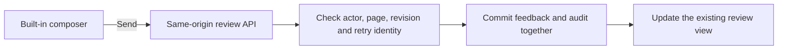

# Review without repeat confirmation

The built-in composer already shows the exact comment, target, screenshot, and
mentions. Its Send action should commit that feedback and show the result in the
same view. A separate browser tab repeats the decision and loses the draft before
the save succeeds.

## Behavioral specification

- Given a signed-in reviewer in a hosted Shiplet or the dashboard preview, when
  they send built-in feedback, then the comment saves inline, the count updates,
  and no confirmation tab opens.
- Given a reviewer using the widget on an external website, when they send new
  built-in feedback, then it saves directly from Shiplet's frame with no
  confirmation popup. Replies and status changes on existing threads still open
  a top-level Shiplet confirmation.
- Given a failed or uncertain save, when the request fails, then the comment,
  capture, and mentions remain available. Retrying the same payload uses the same
  client ID and cannot produce a second ticket.
- Given a changed active revision or a retry with a changed payload, when the
  request reaches persistence, then it cannot commit under the original intent.
- Given an opaque artifact, custom widget, external website, or API credential,
  when it attempts the hosted inline operation, then it cannot acquire ambient
  human authority. The inline route requires same-origin JSON, current review
  membership, and the existing browser session or scoped HttpOnly tenant cookie.
- Given an existing valid browser session, when ordinary `/auth/login` is reached
  during artifact-access recovery, then the existing safe return flow reuses that
  session. Explicit invitation acceptance and adding an account keep their
  dedicated flows. Expired sessions still require sign-in.

The implementation reuses the existing confirmation intent and transactional
effect fence. It does not add a second persistence system or lengthen credential
lifetimes. Custom-widget/workflow requests keep their separate trusted
confirmation.

New feedback from a widget on an external website also saves directly
(`POST /embed/review/feedback`). That route requires Shiplet's own origin, JSON,
the reviewer's site review session for the installation's registered origin,
and the current page and revision, so the host page cannot read the frame or
submit through it. The tradeoff is that the host page controls the surrounding
frame and can cover, resize, or disguise it to mislead a reviewer into sending a
comment. The owner accepted that for new comments, which add a ticket and do
not change existing ones; replies, resolving, and reopening keep their
top-level confirmation, which the page cannot overlay.

## Verification

- `e2e/review-local-recovery.spec.ts` — a hosted Page comment saves in place,
  sends one write, and opens no window.
- `e2e/feedback-inbox.spec.ts` — a failed direct save keeps the draft, and the
  retry reuses the same client ID.
- `e2e/trusted-review-host.spec.ts` — a hosted mention saves without a popup
  and notifies the mentioned owner.
- `e2e/embeddable-widget.spec.ts` — on a real install, new feedback saves from
  the frame with no popup, while reply and resolve still require top-level
  confirmation.
- `test/review-rich-confirmation-api.spec.ts` — the embedded direct route saves
  one same-origin submission, returns the same ticket for a replay, and rejects
  a conflicting payload, another origin, and another page.
