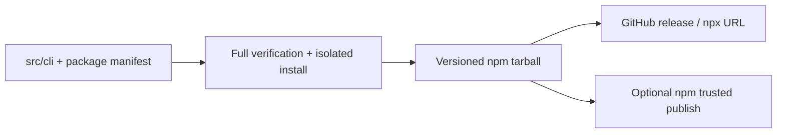

# CLI releases

The application root remains private. `packages/cli/package.json` describes the
small public CLI; `src/cli` remains its single source of truth. The builder copies
an explicit list of CLI modules, license, and package README into a fresh staging
directory. It fails if the pinned parser version differs from the tested root
lockfile. There are no consumer install hooks or application dependencies.



## Verify and build

1. Bump the version in `packages/cli/package.json` and update versioned download
   URLs in README and public docs. Keep MDX and Worker-rendered docs aligned.
2. Run `npm run generate:public`, `npm run verify`, and `npm run test:cli-package`.
   The package test uses an empty temporary project and npm cache. It verifies the
   exact packed file list, executable mode, install, npx help, local prepare,
   invalid command, and both actual-binary browser authorization regressions.
3. Build into a fresh directory outside the repository:

   ```sh
   node scripts/build-cli-package.mjs /tmp/shiplet-cli-release-0.1.1
   npm pack /tmp/shiplet-cli-release-0.1.1/package --pack-destination /tmp/shiplet-cli-release-0.1.1 --ignore-scripts
   ```

4. Review the packed file list. Publish an immutable `cli-v<version>` tag at the
   verified commit. `release-cli.yml` reruns verification and publishes the
   tarball as a GitHub release. Do not overwrite tags or release assets.
5. From a clean temporary directory/cache, run the documented npx download URL
   with `shiplet --help`. Only report public distribution after it succeeds.

## npm ownership and first publication

As checked on 2026-10-16, the unscoped `shiplet@0.2.2` is maintained by
`pilaniaanand` and points to `anandpilania/shiplet`. That is another product.
Plain `npx shiplet` cannot mean this CLI without an authorized ownership transfer.
Never publish over another project's name or represent the URL/scoped command
as equivalent to plain `npx shiplet`.

The intended alternative is `@bintzgavin/shiplet`. A registry 404 is evidence of
non-publication, not proof of scope ownership. The maintainer must authenticate
to an npm account that owns this scope (or explicitly choose another scope),
then publish the exact reviewed tarball. `npm whoami` is sufficient to inspect
account identity; never inspect npm configuration or credential values. Complete
browser login/2FA privately. Do not paste credentials into agent chat.

After the first publication, configure npm trusted publishing for:

- GitHub organization/user: `BintzGavin`
- Repository: `shiplet-core`
- Workflow filename: `release-cli.yml`
- Environment: `npm`

The manual workflow's `publish_npm` option uses OIDC on a matching version tag,
with no stored npm token. Configure the GitHub `npm` environment's approvals as
appropriate. The GitHub release job compares an existing tarball byte-for-byte before
allowing npm publication; it never overwrites an existing release.
For subsequent releases, trigger the manual workflow on the tag with npm enabled.

Verify `npx @bintzgavin/shiplet@<version> --help` from a clean project/cache, then
change public docs to the shorter scoped command and remove the pending notice.
Production website deployment belongs to the separate `shiplet-ops` release flow.
