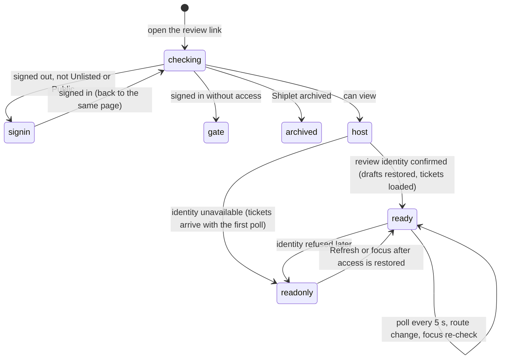

# The review link

## Summary

A review link is where a Shiplet is reviewed: the artifact fills the window, and Shiplet's review layer sits on top of it. This document owns the parts every review feature depends on: how the page is put together, what happens on arrival, how the review layer knows who the reviewer is (review identity), the private connection to the artifact that element selection, pins, and shortcuts need, the keyboard (the Escape ladder, the C shortcut, Ctrl/Cmd+Enter), what happens when the artifact navigates to another of its own pages (a route change), and how the dashboard preview on the Shiplet page differs. Every document under `review/` links here for these and does not restate them. The review link is reached at the Shiplet's address ([navigation and URLs](navigation-and-urls.md#review-link-addresses)); who may open it is in [access and roles](access-and-roles.md).

## How a review link is put together

The page the browser shows is Shiplet's **trusted host**. Its title is "{Shiplet name} · Shiplet". It contains:

- the **artifact frame**, a sandboxed iframe filling the window, showing the artifact's page at the same path as the review link. Scripts and forms in the artifact run, but the frame is isolated from Shiplet: it never sees the reviewer's session and cannot call Shiplet's APIs. A small Shiplet script is added to every HTML page of the artifact so that the trusted host can talk to it (the artifact connection, below).
- the **review layer**, drawn by the trusted host over the artifact: the launcher dock (Annotate, and Comments with a count), the comments panel, pins, the composer, presence avatars and cursors, and the notices. None of it is inside the artifact frame, so the artifact cannot read or click it.
- when an agent attached one, a **custom review widget** in its own frame inside the comments panel (`cross-cutting/custom-review-widgets.md`). There is none by default.

The review layer is styled the same in light and dark themes; it does not follow the Shiplet app's theme switch.

A review link path whose file is not an HTML page (an image, a PDF, a CSS file opened directly) is shown on its own, in a sandbox, without the trusted host or any review layer. A path that does not exist shows the plain text "Shiplet asset not found".

## Arriving

**Before the page.** Opening a review link first checks access. Signed out on a Private or Organization Shiplet, the browser goes to sign-in and comes back to the same page of the review link. Signed in without access, it goes to the access request page (`access/the-access-gate.md`). On an archived Shiplet it shows the archived page instead of the artifact (`shiplets/archive-restore-and-delete.md`). On an unknown address it shows the plain text "Shiplet not found" (a review link on its own host) or the app's plain "404 Not Found" (a path-shaped one).

**The first paint.** The artifact frame starts loading its page and the launcher dock appears at the bottom right (or wherever the reviewer's dock preference puts it) with Annotate and Comments, the count reading 0. The comments panel is closed. Nothing has focus inside the review layer.

**Then, in parallel:**

1. **Review identity is checked** (below). On success, the reviewer's saved drafts for this Shiplet, revision, and page are restored from the browser, their review preferences are applied (a reviewer whose launch preference is "Open comments" sees the panel open now), and the first page of tickets (up to 100, for the remembered filters) is loaded. The count, pins, and the Page comments button then appear.
2. **The artifact connection** is offered as soon as the artifact page has loaded. Until it answers, Annotate still works but waits ("Connecting to the artifact…"), and pins sit at the points where their tickets were captured rather than on their live targets.
3. **Watch status, mention suggestions, and presence** load. Presence shows the reviewer's own avatar ("1 reviewer here") and anyone else on the Shiplet.
4. **Clean link parameters** are applied: `shiplet_review=hidden` hides the launcher dock, and `shiplet_comments=hidden` hides the pins, each with a single "Show review UI" or "Show comments" button in their place (`review/review-settings-and-links.md`).

**From then on**, the ticket list is polled every 5 seconds while the tab is visible ([the page lifecycle](page-lifecycle.md#live-updates-and-polling)). A poll adds new tickets and updates the ones it returns; it never removes a ticket from the list (see `review/the-comments-panel.md` for what that means for closed tickets).

## Who the reviewer is

**Review identity** is the trusted host's confirmation of four things together: who the reviewer is, which Shiplet, which revision, and which page. It is checked on arrival, again whenever the window regains focus or the tab becomes visible, before every Send, after any request is refused (401, 403, or 409), when a pending submission is cancelled, and after every route change. Drafts and review preferences are stored under it, so a different person in the same browser, or the same person on another page or after the Shiplet's active revision changed, never sees them.

While a check is in flight the review layer treats identity as unconfirmed, and a Send started in that moment fails with "Review identity is unavailable. Use Refresh after access is restored." When a check fails, the panel's status line says the same, and a storage notice outside the panel reads "Review identity is unavailable. Saved review content stays private until access is restored." Drafts already on screen stay; nothing is sent; the panel's Refresh and the next focus try again.

**Where the identity comes from** depends on the review link's shape ([navigation and URLs](navigation-and-urls.md#review-link-addresses)):

- **A path on the app** (local development, installations without a custom domain) and **the dashboard preview** use the Shiplet app's own sign-in session.
- **Its own host** (production) cannot see the app's session. The first visit sends the reviewer through the app's access check, which hands back a review pass for that one Shiplet, valid for 5 minutes and stored as a cookie on the review link's host. See Open questions.

**Signed-out visitors** on an Unlisted or Public review link have no review identity. They see the artifact and, from the first poll onward (about 5 seconds), the tickets and pins, but every attempt to send, reply, change a status, or watch fails, and the identity notice stays up.

## The artifact connection

The artifact connection is a private channel between the trusted host and the Shiplet script inside the artifact page. It is opened each time an artifact page finishes loading and is renewed every second; if the artifact does not answer for 3 seconds, the host treats it as disconnected.

| Needs the connection | Without it |
| --- | --- |
| Choosing an element (Annotate, C, Select an element) | Annotate waits with "Connecting to the artifact…"; Select an element is disabled |
| Draw on page (a capture of the visible page) | The choice does nothing |
| Pins that follow their targets as the page scrolls, reflows, or resizes, and hide when their target is hidden or scrolled away | Pins sit at their captured points |
| Revealing a ticket's target from the list or a pin | "Target unavailable" |
| The C and Escape shortcuts pressed while focus is inside the artifact | Only keys pressed in the review layer work |
| Live cursors and following another reviewer | The reviewer's own cursor is not shared; following does nothing |
| Noticing a route change | The review layer stays on the old page |

When the connection drops (the artifact page froze for 3 seconds, or crashed), the stale notice reads "Artifact tracking disconnected. Use Retry to reconnect.", element selection in progress is cancelled, and Select an element is disabled. The notice's button is labeled Refresh and reloads the ticket list; the connection itself comes back only when the artifact page loads again (a route change inside it, or reloading the review link).

## Keyboard

**The Escape ladder.** Escape pressed in the review layer closes the innermost open thing and stops there. In order:

1. an open contextual thread closes (its reply draft is kept, and focus returns to its pin);
2. otherwise, the freehand drawing overlay closes, dropping only the strokes drawn since it opened;
3. otherwise, an expanded composer returns to compact;
4. otherwise, an open composer, annotation mode, or a selection still waiting for the artifact is cancelled, and the composer's draft is **discarded**;
5. otherwise, the comments panel closes.

While the reviewer is following someone, Escape also stops following, in addition to the step above. Escape pressed while focus is inside the artifact is relayed with a shorter ladder: it cancels annotation mode or an open composer (discarding the draft), else closes a contextual thread, else closes the panel. Escape belongs to an IME while a composition is in progress and does nothing in Shiplet then.

**The C shortcut.** C (no Ctrl, Cmd, Alt, or Shift), pressed when no text field, list, or editable area has focus, does what Annotate does: it reopens the composer if a draft exists, and otherwise starts choosing an element. Inside the artifact it works when focus is on the page itself, a link, a button, or a summary, but not in the artifact's own fields; it needs the artifact connection.

**Ctrl/Cmd+Enter** sends from the composer's comment field and from a reply field. Plain Enter adds a line. Neither sends during an IME composition.

**Tab** order follows the page: the artifact's own controls first, then the review layer's (the panel when open, the launcher dock, the composer, pins).

## Routes inside the artifact

The artifact can move to another of its pages inside the artifact frame: a link, a form, a script changing the address, or back and forward within the frame. The Shiplet script notices within a tenth of a second and tells the trusted host, which then:

1. saves every draft for the old page to the browser at once;
2. cancels any element selection in progress and forgets the old page's pin positions;
3. empties the list and shows "Loading comments…";
4. switches its page to the new one and checks review identity for it;
5. reloads the list for the new page (the Current page scope follows the artifact; the other scopes reload too), and restores any drafts saved earlier for the new page.

If the new page cannot be reviewed (for example a page outside the Shiplet), the review layer stays bound to the previous page and the stale notice says "This page route cannot be reviewed until it is reopened through Shiplet."

The browser's address bar does not change: it keeps the address the review link was opened at. Reloading returns the artifact to that first page, and the review layer with it.

## The dashboard preview

The Shiplet page embeds the same review layer in an iframe, and its "Open review page" button opens it on its own (`/shiplets/{id}/review-host`). It behaves as the review link does, with these differences: it is always on the app's host, so it always uses the app's session; tickets sent from it are recorded against the review link's address, so they appear on the review link and the review link's tickets appear here; and its "Open feedback" links open the Shiplet page in a new tab.

## The parts of the review layer

| Part | Described in |
| --- | --- |
| Launcher dock, comments panel, ticket list, filters, pagination, refresh, options menu | `review/the-comments-panel.md` |
| Threads in the panel and beside a pin; replies; Resolve, Reopen, Status | `review/threads-and-replies.md` |
| Pins, pin stacks, the Page comments menu, revealing targets, Hide comments | `review/pins.md` |
| The composer: opening, compact and expanded, moving, Cancel, Send | `review/the-composer.md` |
| Annotation mode, element captures, page captures, capture fidelity | `review/selecting-and-capturing.md` |
| Drawing on screenshots | `review/drawing-on-screenshots.md` |
| Attachments, mentions, copy requests | `review/attachments-mentions-and-copy-requests.md` |
| What Send commits, failure and retry, drafts across reload | `review/sending-and-drafts.md` |
| Presence and following | `review/presence-and-following.md` |
| Settings, clean links, Watch | `review/review-settings-and-links.md` |

## Modifiers

| Modifier | At arrival | During editing |
| --- | --- | --- |
| Role | Every role that can view gets the same review layer. Mention suggestions list only members of the Shiplet's organization, and stay empty for a reviewer who is not a member. Signed-out visitors (Unlisted and Public only) get a read-only layer with the identity notice. | A role lost mid-visit shows at the next request or focus re-check: "Review access changed. Your draft is retained." Drafts stay in the browser under the old identity. |
| Shiplet state | Private and Organization require sign-in; Unlisted and Public open at once. An archived Shiplet shows the archived page, not the review layer. | Archiving the Shiplet mid-visit makes every later poll fail ("Refresh failed. Showing saved comments and drafts.") and every send fail ("Feedback could not be saved. Retry the same submission."); the open page keeps its tickets and drafts, and the next reload shows the archived page. A new active revision published by an agent makes the next send fail with "This review changed. Your draft is retained; refresh before retrying." |
| Flags and preferences | The dock preference places the launcher dock and panel; "Open comments" opens the panel on arrival; Reduce motion stops smooth scrolling; the remembered filters choose the first list; Hide comments, if left on, keeps pins hidden; clean link parameters hide parts. No feature flag applies. | Preferences change at once when set in Settings. |
| Keyboard | C, Escape, Ctrl/Cmd+Enter, and Tab as above. | As above. IME compositions are never interrupted by Shiplet's keys. |
| Narrow screen | At 640 px or less the panel closes by itself after a ticket is sent. At 480 px or less the panel spans the screen's width (and at most 68% of its height), the launcher dock and mode bar sit closer to the edges, and the composer's buttons and the mode bar's Cancel grow to 44 px. | Rotating or resizing re-anchors the composer to its target and moves pins. |

## Cancel and interrupt

| Event | Before editing | While editing or submitting |
| --- | --- | --- |
| Escape or Cancel | The Escape ladder above; with nothing open, nothing happens. | The Escape ladder; step 4 discards the composer's draft. |
| Leaving by a link inside Shiplet | Nothing is recorded. | Drafts are saved to the browser first; a pending send completes on the server and is offered as failed-and-retryable on return ([the page lifecycle](page-lifecycle.md#what-each-interrupt-means)). |
| Browser back or forward | Leaves the review link (the frame's own history is a route change instead). | As leaving. |
| Reload, or the tab or window is closed | A reload repeats arrival at the first page the review link was opened at. | Drafts are restored on reload; the composer reopens with them the next time Annotate or C is used. Attachments are not restored. |
| The window loses focus or the tab is hidden | Polling pauses while hidden. On return, identity is re-checked and the artifact connection restarted. | Drafts are saved the moment the tab is hidden. |
| Network lost | The first load fails with "Could not load comments. Use Refresh to try again." or, when the browser knows it is offline, "You’re offline. Comments will be available when the connection returns." | The list stays with a stale notice; sends fail and keep their drafts; the list refreshes when the browser reports it is back online. |
| Request fails | The status line and stale notice report it; the list keeps what it had. | Each feature reports its own failure where the reviewer is working, and keeps its draft. |
| Session expires or access is revoked | Identity is refused at the next check: the identity notice appears. On a review link with its own host, the review pass expires 5 minutes after it was issued. | "Review access changed. Your draft is retained." Nothing is sent or discarded. |
| The same record changed in another tab | Tickets from the other tab appear within 5 seconds. | Both tabs save the same page's drafts to the same place in the browser; a reload restores whichever saved last. |
| The same record changed by another person | Their tickets appear within 5 seconds and their avatar at once. | Their changes appear within 5 seconds without touching drafts. |
| Autofill, a password manager, or an input method (IME) writes into a field | No effect; the review layer's fields are not autofill targets. | IME compositions suspend Enter, Ctrl/Cmd+Enter, Escape, and mention suggestions until they end. |
| The artifact navigates to another page (review link only) | A route change, as above. | A route change; the old page's drafts are saved first. |

## Edge cases

- **Opening a non-HTML file's address directly** shows it without any review layer, so it cannot be reviewed there; it can be reviewed through the page that shows it.
- **The address bar never follows the artifact.** Sharing the browser's address after navigating inside the artifact shares the first page, not the current one.
- **Escape in a menu or the mention suggestions also climbs the ladder.** The Page comments menu, a pin stack menu, and the mention suggestions close themselves on Escape, and the same keypress then also closes the panel or cancels the composer (`review/the-composer.md`).
- **A Send in the instant after focus returns** from the artifact to the review layer can meet a focus re-check still in flight and fail with the identity message; sending again works.
- **The connection notice names a button that is not there**: it says Retry, and its button says Refresh and does not reconnect.

## Open questions and verification

- On a review link with its own host, the review pass is issued for 5 minutes and is not renewed by later page loads that already carry it. The code that answers the review identity check refuses requests authenticated by a review pass, which would leave every reviewer on such a link without review identity, and so unable to send. No test covers this path (the browser tests run path-shaped links), while `docs/review-widget-parity-audit.md` records production submissions saving in place. Needs verification against a custom-domain deployment before anything else here is trusted for production.
- After the artifact connection drops, nothing reconnects it until the artifact page reloads. Whether long-hidden tabs (where browsers slow timers) come back disconnected was not tested.
- Escape climbing the ladder after a menu or the structured drawing editor handled it looks like a bug: it can discard a whole draft when the reviewer meant to close a menu. May be worth treating as a bug rather than documenting.
- The polling list never drops a ticket, so tickets closed by others linger in an Open scope until Refresh. Confirm by hand.
- The order in which arrival steps finish (identity, connection, list) varies; what a reviewer sees in the first second was not watched.

Verified against shiplet-core commit `3327af4`
