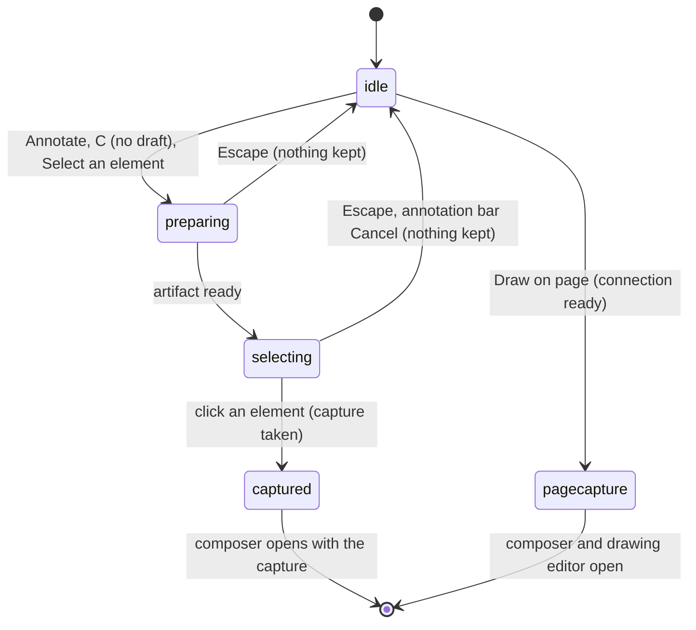

# Selecting and capturing

## Summary

Selecting and capturing is how a ticket gets its context. In **annotation mode** the reviewer points at the artifact and clicks one element; Shiplet records that element as the ticket's target and takes an **element capture**: the point clicked, the viewport and scroll position, the element's selector, tag, and visible text, and a screenshot of the visible page. **Draw on page** takes a **page capture** instead: a screenshot of the visible page with no target, opened straight into the drawing editor. Both feed the composer, which this document hands over to ([the composer](the-composer.md)). Annotation mode is entered from Annotate in the launcher dock, the C shortcut, or Select an element in the comments panel's "+" menu; it shows as a blue outline around the artifact, a slightly darker artifact, and the annotation bar at the top center reading "Annotating · {path}" with a Cancel button. Element selection is pointer-only. It needs the artifact connection ([the review link](../foundations/the-review-link.md#the-artifact-connection)) and works for every role that can view, including signed-out visitors, who can capture but not send.

## The simple case

The reviewer selects Annotate. The launcher dock and the pins disappear, the artifact gets a blue outline, and the annotation bar ("Annotating · /") appears at the top. Moving the pointer over the artifact draws a teal box around whichever element is under it. They click a button in the artifact: the button does not act; instead the box disappears, an orange marker appears at the point clicked with a teal outline around the button, and the composer opens beside it with the comment field focused. Its target, shown when the composer is expanded, reads like "BUTTON · Buy now · main > button.cta".

For a whole-page drawing, the reviewer opens the comments panel, selects "+" (New comment) and Draw on page. The visible part of the artifact is captured, the composer opens with "Page · /" as its target and a note under the comment field saying how faithful the capture is, and the structured drawing editor opens on the screenshot.

## The interaction, event by event

### Arrive

**Annotate, C, or Select an element** first prepares. If the composer already holds a draft, Annotate and C reopen it instead and annotation mode does not start (Select an element in the panel starts it anyway). Preparing sends a request to the artifact to start selection; nothing visible changes yet, except that the panel's status line reads "Preparing element selection…", or "Connecting to the artifact…" while the artifact connection is not yet up, in which case the request waits for it. Pressing Annotate or C again while preparing does nothing.

When the artifact answers, **selecting** begins, all at once: the comments panel closes, any composer and its target marker are hidden, the launcher dock and every pin, pin stack, and Page comments button are hidden, the artifact gets its blue outline and darkens slightly, and the annotation bar ("Annotating · {path}") appears with Cancel. The panel's status reads "Select an element to annotate. Press Escape to cancel."

**Draw on page** (in the panel's "+" menu) needs the artifact connection to be ready; without it, or while an earlier page capture is still running, the choice does nothing. Otherwise the menu closes and the visible page is captured at once ("Capturing the visible page…"). There is no selecting phase.

### Leave untouched

Escape (pressed in the review layer or inside the artifact) or the annotation bar's Cancel ends annotation mode without capturing anything. Everything hidden comes back: the launcher dock, pins, and the Page comments button; the artifact loses its outline; focus returns to Annotate (or to Comments, if selection never got past preparing). No capture is recorded. Escape and Cancel end selection through the same path as cancelling the composer, so if a draft existed when selection began (possible only through Select an element in the panel), that draft is discarded too. Reloading or leaving the page during selection keeps nothing of the selection, and leaves an earlier draft as it was; selection itself is not a draft.

### Begin editing

Moving the pointer over the artifact is the first change. Each element the pointer enters gets the teal selection box (a 3 px border with a light teal fill), drawn by Shiplet inside the artifact page. Elements the artifact has marked private (anything inside an element with `data-shiplet-private`, or Shiplet's own website widget) are skipped: they get no box, and they cannot be chosen.

### While editing

The box follows the pointer from element to element; it is placed when the pointer enters an element and does not move with scrolling until the pointer enters another. The artifact still scrolls normally with the wheel, keyboard, and touch, and other reviewers' cursors are still drawn. There is no keyboard way to move the box or choose an element: selection is done with a pointer (mouse, pen, or tap).

### Submit

**Clicking an element** chooses it. The click is consumed: the artifact's own handlers do not see it, so a link does not navigate and a button does not act. The box disappears and Shiplet records:

- the **target**: a CSS selector (the element's id when it has a simple one, otherwise a path of up to six ancestors with up to two class names each and position among siblings), its tag, and up to 500 characters of its visible text, leaving out private parts, scripts, styles, and form fields;
- the **point** clicked, in page and viewport coordinates, and its offset inside the element;
- the **viewport** (width, height, pixel ratio) and the **scroll position and document size**;
- a **screenshot** of the visible page (below).

Annotation mode ends and the composer opens compact beside the point, with an orange marker on the point and a teal outline with orange corners around the element. The marker and outline follow the element as the page scrolls or reflows for as long as the composer is open. The target line (visible when expanded) reads "{TAG} · {text} · {selector}", Element details lists the viewport, the page offset, and "Element image ready" or "Element context only", and Draw (compact) and Draw on screenshot (expanded) appear when there is a screenshot. Any freehand drawing from an earlier target is dropped.

**Draw on page** captures the visible page instead, unless the artifact moved to another page while capturing, in which case nothing happens. On success the composer opens with "Page · {path}" as its target, the fidelity line describes the capture, the structured drawing editor opens on the screenshot with the reviewer's drawing defaults (`review/drawing-on-screenshots.md`), and the status reads "Visible page captured. Add annotations or continue with a page comment." If no screenshot could be made, the composer opens without the editor and says "Visible page capture was unavailable. Your text-only page comment is still available." A page capture replaces any element target the draft had.

**How screenshots are made.** Shiplet cannot photograph the artifact; it rebuilds the visible part of the page as an image. It copies the page, removes everything that could leak or misbehave (scripts, frames, images, pictures, video, audio, canvas, form fields, linked stylesheets, private elements, and links and sources), places the copy at the current scroll position, and draws it at one image pixel per CSS pixel, at most 1920 by 1080. Pages styled only by linked stylesheets therefore come out unstyled, and images come out blank. Two exceptions: an image Shiplet itself marked for raster capture (as on its file review pages) is drawn exactly, and when rebuilding fails (for example a page over 1 MB of markup) Shiplet draws a plain fallback with the page's visible headings, paragraphs, list items, buttons, links, and labels as text, outlines the element in teal, and records why it failed.

**Capture fidelity** is the line under the comment field. For a page capture it says one of: "Captured from the selected image." (the raster exception); "Reconstructed from the visible page; images, canvas, media, form values, external styles may be omitted."; "Approximate fallback capture." followed by the failure; or "No image attached.". An element capture does not update the line (see Edge cases).

**Changing the target afterwards** happens in the expanded composer. **Remove target** releases the element, turns the draft into a page comment ("Page · {path}"), and hides Remove target and the Draw buttons; the text is kept. **Select element** and **Change element** reuse Annotate's rule and therefore only reopen the draft (collapsing the composer) whenever it has any content, which is always the case once a target exists; see [the composer](the-composer.md#edge-cases).

## Modifiers

| Modifier | At arrival | During editing |
| --- | --- | --- |
| Role | Any role that can view can select and capture. A signed-out visitor on an Unlisted or Public link can too, but cannot send what they capture. | No effect: selection makes no request to the server. |
| Shiplet state | No difference by visibility. | Archiving the Shiplet does not interrupt selection; the send fails later. |
| Flags and preferences | Hide comments makes no difference here, because pins are hidden during selection anyway. The drawing defaults (pen, color #D92D5B, width 5) are used when Draw on page opens the editor. No feature flag applies. | No effect. |
| Keyboard | C starts preparing when no text field has focus and no draft exists. There is no keyboard way to choose an element. | Escape cancels, from the review layer or from inside the artifact. Tab moves focus within the artifact as usual and does not select. |
| Narrow screen | At 480 px or less the annotation bar spans the width and its Cancel is 44 px tall. Selection works by tap. | A tap both shows the box and chooses the element. |

## Cancel and interrupt

| Event | Before editing | While editing or submitting |
| --- | --- | --- |
| Escape or Cancel | Escape while preparing stops it; focus returns to Comments. An earlier draft is discarded. | Escape or the annotation bar's Cancel ends selection with nothing captured, and discards an earlier draft if there was one. After the click (while the capture is being made) there is no cancel; the composer opens when it is ready. |
| Leaving by a link inside Shiplet | Nothing is recorded. | Nothing is recorded; selection is not a draft. |
| Browser back or forward | As leaving. | As leaving. |
| Reload, or the tab or window is closed | Nothing is kept. | Nothing is kept. A capture already handed to the composer is kept as its draft. |
| The window loses focus or the tab is hidden | No effect; preparing continues. | No effect; selection is still on when the reviewer returns. |
| Network lost | No effect: selection and capture never use the network. | No effect. |
| Request fails | Not applicable: no request is made. | Not applicable. |
| Session expires or access is revoked | No effect on selection. | No effect; the composer reports it at Send. |
| The same record changed in another tab | No effect. | No effect. |
| The same record changed by another person | Their new tickets arrive by polling; their pins stay hidden until selection ends. | As before editing. |
| Autofill, a password manager, or an input method (IME) writes into a field | No effect. | Escape during an IME composition inside the artifact does not cancel selection. |
| The artifact navigates to another page (review link only) | While preparing, the artifact page reloading restarts the request on the new page. | Selection stops working inside the artifact (the element box and the click capture are gone), but the annotation bar, the outline, and the hidden pins remain until Escape or Cancel. A capture in progress is dropped. |

After an interrupt the reviewer is back on the review link with nothing captured, except when the capture had already reached the composer.

## Interactions with other systems

**Permissions and roles.** None: nothing about selecting or capturing is checked by the server. Authority is checked when the ticket is sent.

**Validation and error display.** Captures are checked by the trusted host for shape and size; a malformed one from the artifact is ignored, and the reviewer sees selection simply continue. Draw on page reports an unavailable capture in the composer.

**Unsaved changes and drafts.** A capture becomes part of the composer's draft and is saved to the browser with it, including the screenshot. Selection itself is never saved.

**Undo.** None. Remove target is the way back from a target; a capture cannot be retaken except by cancelling the draft and starting again (Change element does not do it).

**Optimistic updates and rollback.** Not applicable.

**Offline and reconnection.** Works entirely offline. It needs only the artifact connection.

**Live updates and collaboration.** Polling continues during selection, but pins are hidden. The reviewer's cursor keeps being shared with other reviewers.

**Status messages and notifications.** The annotation bar is the visible cue; the panel's status texts during selection are mostly unseen because the panel is closed. Nothing notifies anyone.

**URL and browser storage.** The URL never changes. Captures, including screenshots up to about 13 MB as text, are stored with the draft in IndexedDB.

**Localization and time.** English only.

**Accessibility.** Element selection cannot be done from the keyboard, so keyboard and screen reader users can write page comments but cannot attach a target. The annotation bar is announced politely when it appears. The selection box and markers are visual only.

**Side effects others notice.** None until the ticket is sent. The artifact never learns which element was chosen, and the click is not delivered to it.

## Edge cases

- **The fidelity line is wrong for element captures.** It keeps whatever it said before: "No image attached." on a fresh composer, even though Element details says "Element image ready", or the previous page capture's wording.
- **The screenshot is the whole visible page, not the element.** The element is not marked in the image, except in the fallback drawing.
- **Large windows are cropped.** Above 1920 by 1080 CSS pixels, only the top left 1920 by 1080 of the view is captured.
- **High-density screens get a 1x image.** The screenshot is drawn at one pixel per CSS pixel whatever the pixel ratio, which the capture records.
- **Linked stylesheets and images are missing** from rebuilt screenshots; inline styles survive. The fidelity line says so for page captures only.
- **Private elements pass clicks through.** Clicking inside an element marked private during selection is not captured and reaches the artifact, so a private link navigates.
- **Escape while re-targeting discards the draft.** Starting Select an element from the panel while a draft exists, then pressing Escape, loses the draft's text as well as the selection.
- **Pressing Annotate during preparing** is ignored; there is no visible sign that preparing is under way when the panel is closed.
- **A connection that drops during selection** leaves the annotation bar up and selection dead, as with a route change; Escape recovers.

## Open questions and verification

- The fidelity line not updating on element captures looks like a bug; `docs/review-widget-parity-audit.md` CREATE-07 lists honest evidence feedback as accepted locally. May be worth treating as a bug rather than documenting.
- A route change or dropped connection during selection leaving the annotation bar and hidden pins with no working selection was read from code, not tried.
- The scroll offset of rebuilt screenshots was a production defect (CREATE-06, closed locally); the current code applies the offset. Confirm with a page scrolled 1,000 px.
- Whether the 1920 by 1080 crop and the 1x drawing are intended was not determined.
- Element selection being pointer-only has no keyboard alternative; this is a product question for accessibility.
- How the selection box behaves on touch screens (a tap both hovering and clicking) was not tried.

Verified against shiplet-core commit `3327af4`
