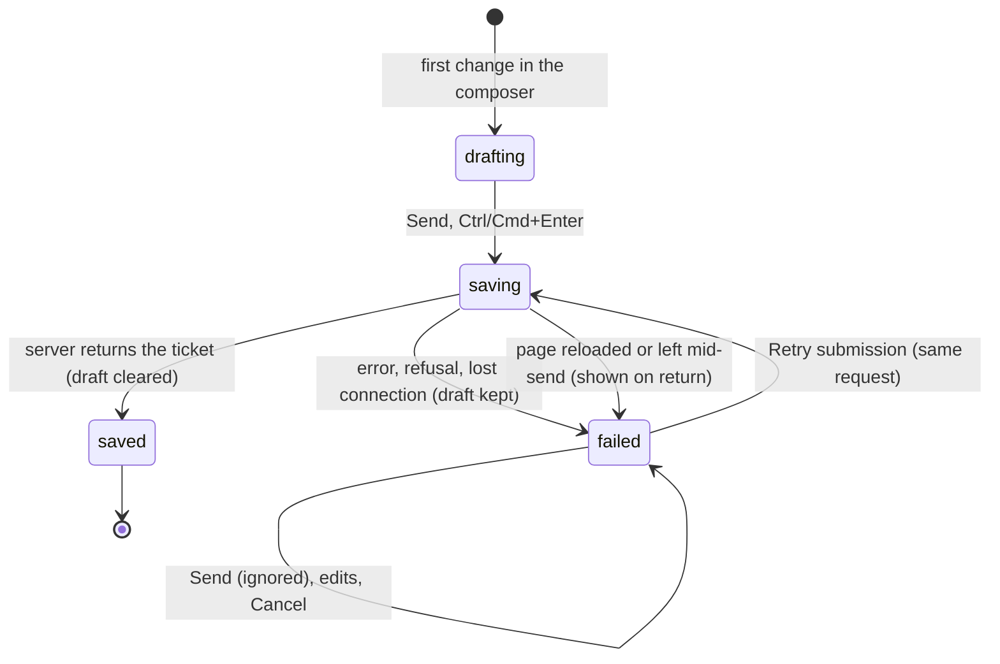

# Sending and drafts

## Summary

This document owns what happens to review-layer work between the reviewer's first keystroke and a saved ticket: how unsent work is kept in the browser as a draft, how Send turns the composer's draft into exactly one ticket, what a failed send looks like and how Retry submission resends it without ever creating a duplicate, and what comes back after a reload. It applies to the composer on a review link and on the dashboard preview. Drafts also cover the text typed into reply fields; sending a reply is owned by `review/threads-and-replies.md`. The composer's own controls are in [the composer](the-composer.md); the meaning of every interrupt is in [the page lifecycle](../foundations/page-lifecycle.md). Sending needs a confirmed review identity ([the review link](../foundations/the-review-link.md#who-the-reviewer-is)) and working browser storage, and is open to every role that can view.

## The simple case

The reviewer has written a comment in the composer and selects Send. The composer's fields and buttons go grey and it reads "Saving feedback…". About a second later the composer closes, the ticket (say PF-12) appears at the top of the comments list, and the count goes up. Nothing else is needed: the ticket is saved, and nobody had to confirm anything in another tab.

If the network drops at that moment, the composer stays open with everything in it and says "Feedback could not be saved. Retry the same submission." under the comment field, with a Retry submission button. When the connection is back, Retry submission sends the same request again; if the first attempt had in fact reached the server, the reviewer gets PF-12 back rather than a second ticket.

If instead the reviewer closes the tab with a half-written comment, reopening the review link and pressing Annotate (or C) brings the composer back with the comment, target, capture, and drawing as they were.

## The interaction, event by event

### Arrive

On arrival, once the review identity is confirmed, the review layer opens its storage in the browser and looks for a record saved under exactly this identity: the same person, Shiplet, active revision, and page address, query string included. If one exists it restores, without opening the composer:

- the composer's comment text and copy request text, its chosen mentions, its target and capture (with the screenshot and any applied drawing), and any freehand strokes;
- the text and mentions typed into each thread's reply field;
- whether pins were hidden with Hide comments;
- the record of earlier submissions. If the most recent one was still being saved, or had failed, it comes back as failed, with the message "This submission may have reached the server. Retry to safely resend the same saved request." and a Retry submission button, shown when the composer next opens.

Attachments are never restored. A record that does not read back correctly is ignored, and the storage notice says "Saved review state was corrupt and was not restored." If the browser offers no storage at all, the storage notice says "Persistence is unavailable; a full reload can lose unsaved work." with a Retry storage button.

The same restore runs after a route change inside the artifact, for the new page.

### Leave untouched

A composer that is opened and left without changes writes nothing new. A draft restored on arrival stays stored until it is sent or cancelled. Records that hold nothing worth keeping are cleaned up as others are saved: beyond the 32 most recent, empty ones are deleted.

### Begin editing

Every change to the composer (typing, choosing mentions, a new capture, a drawing applied, a copy request, adding or removing an attachment) marks the draft as changed and saves it about 150 ms later. Typing in a reply field updates that thread's draft in memory but does not save by itself; it is written with the next save of any kind.

### While editing

The draft is saved again after each change, and at once whenever the tab is hidden, the page is left or reloaded, the artifact changes page, or Cancel is pressed during a send. A save writes the whole record for this identity, so two tabs on the same page write over each other; the later one wins. A record larger than 80 MiB is not saved, silently.

### Submit

**Before anything is sent**, Send does nothing at all when: the comment is empty (the Send button shows the browser's "Please fill out this field"; Ctrl/Cmd+Enter is silent); a send is already in progress; or an earlier submission is failed and this is not Retry submission (see Edge cases). If the review identity is not confirmed at that instant, the composer says "Review identity is unavailable. Use Refresh after access is restored." and sends nothing.

**Then the composer freezes the draft**: the trimmed comment, up to 20 mentions, a copy of the capture with its screenshot and drawing, the copy request if Copy requests is on, and the attachments (which are read from disk at this point). It gives this submission a fresh identity of its own, disables every control in the composer except Cancel, stops drawing on the screenshot, and shows "Saving feedback…".

**It checks the review identity again.** If the identity changed or cannot be confirmed now, the send stops without saying so: the composer's controls come back, but its message still reads "Saving feedback…", and only the storage notice outside the composer reports "Review identity is unavailable. Saved review content stays private until access is restored." Nothing was recorded, so Send works again.

**It records the submission in the browser before sending it.** If the browser refuses to store it, the send stops as failed ("Feedback could not be saved. Retry the same submission."). This means a review layer without working storage cannot send tickets at all (see Open questions).

**It sends one request.** The server checks that the reviewer is signed in and can still view the Shiplet, that the Shiplet is not archived, that the revision is still the active one, and that the page belongs to the Shiplet; then it saves the ticket, its screenshot, attachments, drawing, copy request, and mentions together, and notifies watchers and mentioned people. The server remembers the submission's identity: the same submission sent again returns the ticket it already saved.

**Saved.** The submission is marked completed in the browser. If the draft was not changed since it was frozen, the composer clears (comment, mentions, target, capture, drawing, attachments, copy request), closes, and says "Feedback sent"; the ticket is added to the top of the list, and on a screen 640 px wide or less the panel closes. If the draft had been changed since (only possible when the send was a Retry submission after edits), the composer stays open with the newer draft and says "Feedback sent. Your newer draft is still here."

**Failed.** The submission is marked failed in the browser, the draft stays exactly as it was, the composer's controls are enabled again, and the composer shows one of:

- "Review access changed. Your draft is retained." when the server refused the reviewer or the page (signed out, access removed, a page that does not belong to the Shiplet);
- "This review changed. Your draft is retained; refresh before retrying." when the Shiplet's active revision changed;
- "Feedback could not be saved. Retry the same submission." for everything else: a lost connection, a server error, an archived Shiplet, or a malformed request.

A Retry submission button appears under the message.

**Retry submission** re-checks the identity and sends the very same request again, byte for byte, with the same submission identity, so it cannot create a second ticket: if the first attempt was saved, the server returns that ticket; if not, it saves it now, once. It sends what was frozen at the first attempt, not what the composer shows now. Retry only works on the same page and identity the submission was made on; elsewhere it does nothing.

## Modifiers

| Modifier | At arrival | During editing |
| --- | --- | --- |
| Role | Drafts are stored per person: a different person signed in on the same browser sees none of them. Any role that can view can send. Signed-out visitors cannot send ("Review identity is unavailable…"). | Losing access mid-draft: the next send fails with "Review access changed. Your draft is retained."; the draft stays stored under the old identity and comes back if access returns. |
| Shiplet state | Drafts are stored per revision: after an agent publishes a new active revision, drafts written against the old one are not shown (they stay stored). | A new active revision mid-draft: "This review changed. Your draft is retained; refresh before retrying." Archiving mid-draft: "Feedback could not be saved. Retry the same submission." |
| Flags and preferences | No feature flag applies. A clean link (`shiplet_review=hidden`, `shiplet_comments=hidden`) is a different page address, so it has its own drafts. | Turning Copy requests off before sending leaves the copy request out of the ticket. |
| Keyboard | No effect. | Ctrl/Cmd+Enter sends from the comment field; nothing sends during an IME composition. Retry submission has no shortcut. |
| Narrow screen | No effect. | At 640 px or less a successful send also closes the comments panel. |

## Cancel and interrupt

| Event | Before editing | While editing or submitting |
| --- | --- | --- |
| Escape or Cancel | Nothing to discard. | Cancel or Escape discards the composer's text, mentions, target, capture, and drawing from the screen; the stored copy follows at the next save (at once when a capture was discarded). It does not clear attachments, the copy request, or a failed submission. While a send is in flight, the Cancel button only saves the draft; Escape and the bar's Cancel clear the screen, but the request still completes and the ticket is saved. |
| Leaving by a link inside Shiplet | Nothing new is recorded. | The draft is saved first. A send in flight still completes on the server; on return it shows as failed with "This submission may have reached the server…", and Retry submission returns the saved ticket. |
| Browser back or forward | As leaving. | As leaving. |
| Reload, or the tab or window is closed | The stored draft comes back. | As leaving; attachments are lost. |
| The window loses focus or the tab is hidden | No effect. | The draft is saved at once. A send in flight completes in the background. |
| Network lost | No effect. | Send fails with "Feedback could not be saved. Retry the same submission."; Retry submission once the connection is back. If the request had reached the server, Retry returns the saved ticket. |
| Request fails | No effect. | The failed state and messages above. |
| Session expires or access is revoked | No effect until a send. | "Review access changed. Your draft is retained." |
| The same record changed in another tab | The other tab's saves can replace this page's stored draft; a reload restores whichever was saved last. | Both tabs keep their own on-screen drafts and overwrite each other's stored copy. A submission sent from one tab is unknown to the other. |
| The same record changed by another person | No effect: drafts are private. | No effect. |
| Autofill, a password manager, or an input method (IME) writes into a field | No effect. | Text being composed in an IME is saved like any other text once committed. |
| The artifact navigates to another page (review link only) | The new page's stored draft is restored. | The old page's draft is saved first. A failed submission from the old page still blocks Send on the new page, and its Retry submission does nothing there. |

## Interactions with other systems

**Permissions and roles.** The server checks viewing access at send time; there is no other permission check. Drafts are keyed to the person, so they never leak to another account in the same browser.

**Validation and error display.** A non-empty comment is the only check before sending. Server refusals are collapsed into the three messages above, under the comment field; raw server text is never shown. A malformed stored draft is reported once in the storage notice and skipped.

**Unsaved changes and drafts.** This document is where they are defined; see Arrive and While editing. The page never asks before leaving, because the draft is already stored.

**Undo.** None. A sent ticket cannot be unsent, edited, or deleted.

**Optimistic updates and rollback.** None. The ticket is shown only once the server returns it; a failed send changes nothing in the list.

**Offline and reconnection.** Drafting works offline. Sending fails while offline and is resent by hand with Retry submission; nothing resends automatically.

**Live updates and collaboration.** Other reviewers see the ticket within 5 seconds of it being saved, through their own polling. Nobody sees drafts.

**Status messages and notifications.** Results appear under the comment field and in the panel's status line. The storage notice reports storage problems with a Retry storage button. A saved ticket notifies the Shiplet's watchers and anyone mentioned (`cross-cutting/notifications-and-watching.md`).

**URL and browser storage.** Drafts and the record of submissions live in IndexedDB (`shiplet-review-drafts-v1`), one record per review identity, with the 32 most recent empty records kept. They are cleared only by sending, cancelling, or clearing site data. Private windows lose them on close.

**Localization and time.** English only. Stored submissions carry timestamps that are never shown.

**Accessibility.** The composer's message is a status region, and an alert when it reports a failure; the storage notice is a status region. Retry submission is a normal button in the composer's tab order.

**Side effects others notice.** A saved ticket: the ticket itself, its pin, notifications to watchers and mentioned people, and possibly a new reviewer grant for a mentioned member ([Shiplets and tickets](../foundations/shiplets-and-tickets.md#mentions)). Failed and retried sends leave no trace for others.

## Edge cases

- **A failed submission blocks every later Send.** While the latest submission is failed, Send does nothing at all, on this page and on others, even after Cancel discards the draft and a new one is written; the composer keeps offering Retry submission. Only a Retry that succeeds unblocks it. A reload does not help: the failed submission is restored too.
- **Retry sends the old text.** Edits made after a failure are not part of Retry submission; they stay as a newer draft after it succeeds.
- **A send that stops at the identity check keeps saying "Saving feedback…".** The composer's controls come back and nothing was sent, but its message is never replaced; only the storage notice explains.
- **A saved ticket reported as failed.** If the browser cannot update its record after the server saved the ticket, the composer says the feedback could not be saved; Retry submission then returns the saved ticket.
- **The query string splits drafts.** Drafts are stored per page address including its query, while tickets are matched to pages ignoring the query. A draft written at `/pricing?ref=mail` does not appear at `/pricing`.
- **Mentions can be lost on restore.** Restored mentions are re-selected only if the list of people has already loaded; otherwise the draft comes back without them.
- **Reply drafts are saved only alongside something else.** A reply typed and abandoned without any other change is stored only when the tab is hidden, the page is left, or the composer saves.
- **Unapplied structured drawings are not drafts.** Shapes drawn in the structured editor are kept only once Apply has been pressed.

## Open questions and verification

- Without working browser storage (storage blocked for the site, or IndexedDB unavailable) every send fails, because the submission must be recorded before it is sent. The storage notice suggests only that a reload could lose work. May be worth treating as a bug rather than documenting.
- A failed submission blocking all later sends until a successful Retry, including on other pages after a route change, looks like a bug. Read from code; confirm with a forced failure followed by Cancel and a new draft.
- The 80 MiB record limit, the 32-record cleanup, and the 64 stored submissions were read from code, not exercised.
- Lost-response retry is covered by `e2e/feedback-inbox.spec.ts` ("retries a committed inline comment after a lost response without duplicating it"); the large-capture persistence path (`docs/review-widget-parity-audit.md` WRITE-07) remains open there.
- The send that stops silently at the identity check, leaving "Saving feedback…" on screen, looks like a bug. Read from code.
- Whether "Saving feedback…" is visible long enough to read on a fast connection was not watched.

Verified against shiplet-core commit `3327af4`
