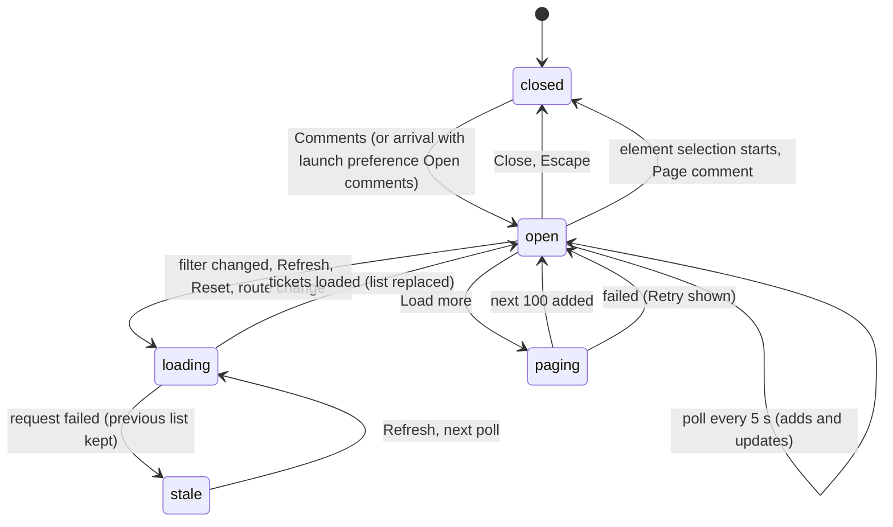

# The comments panel

## Summary

The comments panel is the review layer's list of tickets. It opens from Comments in the launcher dock and lists, newest first, the tickets in the current scope (by default: open tickets on the current page, from every revision, by everyone), each as a two-line summary that expands into its thread. Its header holds Previous and Next, "+" (New comment, the way to start a page comment, a page drawing, or an element selection), an options menu (•••: Watch artifact, Refresh, Hide comments, Settings), and Close; below it sit the Filters, the status line, the list, and Load more. It is a 380 px card at the corner set by the reviewer's dock preference (bottom right by default), up to 600 px tall and scrolling inside. While it is open the launcher dock is hidden. Everyone who can view the Shiplet can use it; signed-out visitors on an Unlisted or Public link see its list fill in with the first poll. This document owns the launcher dock, the panel's opening and closing, the list's loading, empty, stale, and error states, polling and Refresh, the filters, pagination, and Previous and Next. Threads inside it are in `review/threads-and-replies.md`, pins in `review/pins.md`, and the options it only links to (Watch artifact, Hide comments, Settings) in `review/review-settings-and-links.md` and `review/pins.md`.

## The simple case

The reviewer selects Comments (the count reads 3). The dock disappears and the panel opens at the bottom right with focus on its Close button. It lists three tickets, each showing its author, when it was written, its label (PF-3, PF-2, PF-1), its status, and the first two lines of its comment. A line under the header reads "Current page · Open · All revisions · Everyone". Under the list: "3 comments loaded · End of results".

They select PF-2: its thread expands in place, and the artifact scrolls to its target. They select Close: the panel closes, the dock comes back, and focus returns to Comments. While the panel was open, a teammate's new ticket appeared at the top of the list within 5 seconds, without anything being pressed.

## The interaction, event by event

### Arrive

**The launcher dock** appears on arrival at the corner set by the dock preference: Annotate (orange, "Annotate this revision · C") and Comments with a count. The count is the number of tickets loaded for the current scope, not the Shiplet's total: 0 until the first load finishes, then up to 100, and more after Load more. The dock hides whenever the panel, a contextual thread, or the composer is open, and comes back when they close.

**Opening the panel.** Comments opens it and moves focus to Close. If a ticket's thread was open beside its pin, that thread moves into the panel, expanded in the list. A reviewer whose launch preference is "Open comments" finds the panel already open on arrival. Opening the panel loads nothing new; the list has been loading and polling since arrival ([the review link](../foundations/the-review-link.md#arriving)).

**What it shows, top to bottom:**

- **The header.** "Comments", and under it the current page's path, which expands into "Shiplet {id} · Revision {id} · {path}". Then the actions: ↑ (Previous comment) and ↓ (Next comment), hidden when fewer than two tickets are loaded; "+" (New comment); "•••" (Review options); Close.
- **The creation menu**, hidden until "+" is selected: Page comment, Draw on page, Select an element ([the composer](the-composer.md#arrive), [selecting and capturing](selecting-and-capturing.md)).
- **The filter bar**: a Filters disclosure, a one-line summary of the scope ("Current page · Open · All revisions · Everyone"), and Reset when the scope differs from the default.
- **The status line**: "Loading comments…", "No comments yet in this scope. Reset filters or add a comment.", or an error. A plain count ("3 comments.") is kept off the screen; the count is in the dock.
- **A pin limit notice**, only when the page has more than 250 targeted tickets ("250 of {n} page pins shown. All comments remain in the list; selecting a comment reveals its pin.").
- **The list.** One row per ticket, newest first: author (their email, or "Reviewer"), time (in the browser's locale, like "Oct 7, 3:04 PM"), label, status, and the first two lines of the comment. Selecting a row expands its thread in place (`review/threads-and-replies.md`).
- **Pagination**: "{n} comments loaded", with " · End of results" once there is nothing more; Load more while there is; Retry after a failed page.

### Leave untouched

Opening and closing the panel changes nothing and records nothing. Close, or Escape when nothing inside the panel is open, closes it and returns focus to Comments; the dock reappears. The panel also closes by itself when element selection starts and when Page comment opens the composer. Reply drafts typed in its threads are kept ([sending and drafts](sending-and-drafts.md)). Whether the panel was open is not remembered: after a reload it is closed again unless the launch preference opens it.

### Begin editing

For the panel, editing is changing the scope or paging. Opening Filters reveals four controls:

- **Page scope**: Current page (tickets written on this page; the query string and fragment do not count, except a `#/` route), Path prefix (this exact path and everything under it with a "/", on the same origin), or All authorized pages (every page of the Shiplet).
- **Path prefix** (shown only for that scope): an address field prefilled with the current page, an Apply prefix button, and the help text "Matches this exact path and its / descendants on the authorized origin."
- **State**: Open (the default), Closed, or Open and closed.
- **People**: Everyone (the default), Mine (tickets this reviewer wrote), or Mentions of me.
- **Revision**: All revisions (the default) or Current revision.

The first change to any of them applies at once; there is no separate Apply, except for the prefix, which applies on Apply prefix or Enter. A prefix that is not an address on the same origin, or that has a query or fragment, is refused under the fields with "Enter a path on the authorized review origin without query parameters or a fragment." and nothing reloads. Choosing the Path prefix scope applies the prefilled prefix at once.

### While editing

**A scope change reloads the list** while keeping the old one readable: the old tickets stay, the stale notice above the dock reads "Loading the new filter. Showing comments from the previously loaded scope until it succeeds.", the summary line already describes the new scope, and Load more is hidden. When the first page of the new scope arrives, it replaces the list and the notice disappears. A scope the server will not accept shows "These filters are not valid for the authorized review scope. Adjust them and try again." under the fields. The scope is saved in the browser at once, for this Shiplet, and is the starting scope on every later visit until Reset.

**Polling** asks for the first page of the current scope every 5 seconds while the tab is visible. A poll adds tickets that are new, and replaces the ones it returns with their current versions, placing them first; tickets already in the list that the poll did not return stay where they are, as they were. A poll never removes a ticket (see Edge cases).

**Load more** asks for the next 100 tickets of the same scope and adds them below; the dock's count grows with them. A failed page leaves the list untouched and shows "Could not load more comments. Existing comments and drafts are unchanged." with Retry, which asks for the same page again.

**Previous and Next** move through the loaded list, wrapping around: Next from nothing selected opens the first ticket, Previous the last. Each opens the ticket's thread in the list, scrolls its row into view, moves focus to it, and asks the artifact to reveal its target.

### Submit

**Refresh** (in •••, or on the stale notice) reloads the first page of the current scope and replaces the list with it, which is the only way, short of a reload, to drop tickets that no longer belong in the scope. The open thread stays open even if its ticket is no longer in the results. Refresh is disabled while a load is in progress.

**Reset** returns every filter to the default (Current page, Open, Everyone, All revisions), saves that, and reloads like any scope change.

**When a load fails** the list keeps what it had and the stale notice says why, with a Refresh button:

- "Refresh failed. Showing saved comments and drafts." when tickets were already showing;
- "Could not load comments. Use Refresh to try again." (also in the status line) when nothing was;
- "You’re offline. Showing saved comments and drafts." or, with nothing loaded, "You’re offline. Use Refresh when the connection returns." and the status line "You’re offline. Comments will be available when the connection returns." when the browser knows it is offline;
- "Review access changed. Showing saved comments and drafts." or "Review access was denied. Use Refresh after access is restored." (with "Review access was denied. Reopen the review or ask the owner for access." in the status line) when the server refused the reviewer.

The next successful load or poll clears the notice. A failure during polling shows the same notice, and polling keeps trying every 5 seconds.

## Modifiers

| Modifier | At arrival | During editing |
| --- | --- | --- |
| Role | Every role that can view sees the same panel and the same tickets. Mine and Mentions of me filter by the reviewer's own account. A signed-out visitor's list stays empty until the first poll (about 5 seconds), and Mine and Mentions of me find nothing for them. | Losing access turns the next load into the access messages above; the list keeps what it had. |
| Shiplet state | No difference by visibility. On an archived Shiplet there is no panel (the archived page is shown). | Archiving mid-visit makes every later load fail with "Refresh failed. Showing saved comments and drafts." |
| Flags and preferences | The dock preference sets the corner of the dock and the panel; "Open comments" opens the panel on arrival; the saved scope is the first one loaded; The operating system's reduced-motion setting (not the Motion preference) makes Previous and Next jump instead of scrolling smoothly. With a custom review widget, a Custom actions entry and the widget appear in the panel (`cross-cutting/custom-review-widgets.md`). No feature flag applies. | Changing the dock in Settings moves the open panel at once. |
| Keyboard | Opening moves focus to Close. Tab moves through the header, filters, rows, and pagination in that order. | Escape closes the panel when nothing inside it is open (the Escape ladder in [the review link](../foundations/the-review-link.md#keyboard)). Enter in the prefix field applies it. |
| Narrow screen | At 480 px or less the panel spans the width of the screen (8 px from each side) and at most 68% of its height. | At 640 px or less the panel closes by itself after a ticket is sent from the composer. |

The scope is read when a load starts; changing it while a load is in flight abandons that load's result and starts another.

## Cancel and interrupt

| Event | Before editing | While editing or submitting |
| --- | --- | --- |
| Escape or Cancel | Escape closes the panel, unless a contextual thread, a drawing, or the composer is open, which close first. | Escape closes the panel; a scope change in flight still completes and its result is shown next time the panel opens. A failed Load more's Retry stays offered. |
| Leaving by a link inside Shiplet | Nothing is recorded. The scope stays saved. | The scope is already saved; reply drafts are saved. |
| Browser back or forward | As leaving. | As leaving. |
| Reload, or the tab or window is closed | The panel is closed after reload unless the launch preference opens it. The scope comes back. | The same; pages loaded with Load more are not kept, and the list starts again from the first 100. |
| The window loses focus or the tab is hidden | Polling pauses while hidden and resumes on return. | No effect on a load in flight. |
| Network lost | The next poll fails: the offline notice appears and the list stays. The list refreshes by itself when the browser reports it is back online. | A scope change or Load more fails with the messages above; the old list stays. |
| Request fails | The stale notice; the list stays. | The stale notice, or the filter error for a refused scope, or the Load more error with Retry. |
| Session expires or access is revoked | The access messages above at the next poll. | The access messages; the list stays. |
| The same record changed in another tab | Tickets created or changed in the other tab appear within 5 seconds. A scope changed in the other tab is saved for later visits but does not change this tab's panel. | As before editing. |
| The same record changed by another person | Their new tickets and changed statuses appear within 5 seconds for tickets the poll returns. A ticket they close stays listed, with its old status, in an Open scope until Refresh. | As before editing. |
| Autofill, a password manager, or an input method (IME) writes into a field | The prefix field is not an autofill target. | Enter that ends an IME composition in the prefix field does not apply it. |
| The artifact navigates to another page (review link only) | The list empties to "Loading comments…" and reloads for the new page with the same filters; a Current page scope follows the artifact. Load more pages and the stale notice are dropped. | As before editing; a load in flight for the old page is abandoned. |

After an interrupt the panel keeps whatever list it last loaded, and the reviewer recovers with Refresh or by waiting for the next poll.

## Interactions with other systems

**Permissions and roles.** The list holds every ticket in the scope that the server will show the reviewer, which is every ticket on the Shiplet for anyone who can view it. Nothing in the panel is hidden by role.

**Validation and error display.** Only the prefix is checked in the panel; the server's refusal of a scope appears under the filters. Load failures appear in the stale notice and the status line, never as raw server text.

**Unsaved changes and drafts.** The panel itself holds no unsent work. Reply fields in its threads do, and are kept as drafts ([sending and drafts](sending-and-drafts.md)).

**Undo.** None needed; Reset returns the scope to the default.

**Optimistic updates and rollback.** None. The list shows only what the server returned, plus a ticket the reviewer just sent.

**Offline and reconnection.** The list stays readable offline with the offline notice, and refreshes by itself when the browser reports the connection is back.

**Live updates and collaboration.** Polling every 5 seconds is the panel's only source of other people's changes, with the merge rule described in While editing. Presence is separate (`review/presence-and-following.md`).

**Status messages and notifications.** The status line (announced, and as an alert for errors) and the stale notice outside the panel, above the dock. The panel creates no notifications.

**URL and browser storage.** The URL never changes. The scope is saved in local storage per Shiplet and site (`shiplet.review.filters.v1:{origin}:{Shiplet id}`), so the dashboard preview and a path-shaped review link of the same Shiplet share it, and a review link on its own host keeps its own.

**Localization and time.** English only. Times are shown in the browser's locale and time zone.

**Accessibility.** The list is labeled "Review comments" and marked busy while loading. Each row is labeled with its ticket label, status, and comment, and its summary is a button. Previous, Next, New comment, Review options, and Close have accessible names. Focus moves to Close on opening and back to Comments on closing.

**Side effects others notice.** None. Reading, filtering, and paging are private; only Watch artifact (in •••) and the threads' actions change anything others see.

## Edge cases

- **Closed tickets linger.** A ticket that leaves the scope (resolved by someone else in an Open scope, or by the reviewer's own status change elsewhere) stays in the list, showing its old status, until Refresh, a scope change, or a reload. Polling cannot remove it.
- **The count is what is loaded,** not the Shiplet's total: a page with 140 tickets shows 100 until Load more.
- **A just-sent ticket is listed regardless of scope,** at the top, until the next Refresh or scope change.
- **An empty scope** says "No comments yet in this scope. Reset filters or add a comment." even when the Shiplet has tickets elsewhere.
- **The creation menu stays open** until "+" is selected again or one of its items is chosen; Escape closes the whole panel instead.
- **Previous and Next skip nothing and include closed tickets** when the scope lists them; with one ticket they are hidden.
- **Scope survives everything but Reset.** A reviewer who chose Closed once will open every later visit to this Shiplet on Closed.

## Open questions and verification

- Polling never removing tickets, so that closed or re-scoped tickets linger with an outdated status until Refresh, looks unintended. May be worth treating as a bug rather than documenting.
- The pin limit notice is shown inside the panel, so it is invisible while the panel is closed and pins are capped. Read from code.
- `docs/review-widget-parity-audit.md` PAGE-01 through PAGE-07 (page filter, path prefix, resolved filter, Mine and Mentions, pagination) are recorded as closed locally; this document describes that implementation.
- Whether a load abandoned by a quick second scope change can still briefly show its result was not tried; the code discards stale results.
- Time formatting was read from code (browser locale, month, day, hour, minute), not watched.

Verified against shiplet-core commit `3327af4`
