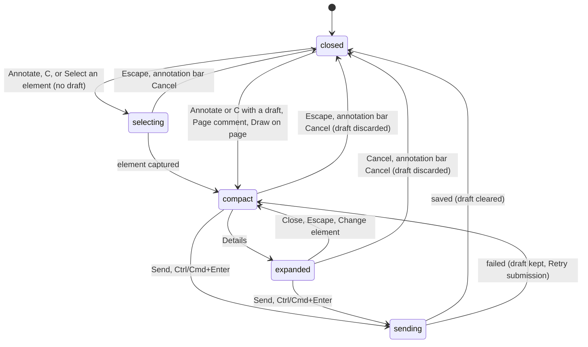

# The composer

## Summary

The composer is the card where a new ticket is written. It floats over the artifact on a review link or the dashboard preview, next to the element the ticket is about, or near the bottom right of the window for a page comment. It opens from Annotate in the launcher dock, from the C shortcut, from the comments panel's "+" (New comment) menu, and by itself when an element or page capture arrives; while it is open, the launcher dock is hidden and the annotation bar at the top of the window reads "Annotating · {path}" with a Cancel button. It has two sizes. **Compact** (the default) shows the comment field, the capture fidelity line, Attachments, and a row with Details, Draw (when there is a screenshot), and Send. **Expanded** (after Details) adds a header ("New annotation", the revision and page, Drag, Close), the target line, Element details, Mention reviewers, the target controls, and a Cancel button. Anyone who can view the Shiplet can write and send; a signed-out visitor on an Unlisted or Public link can type but cannot send. This document owns how the composer opens, its two sizes, where it sits, and the difference between closing and cancelling. Choosing the target is in [selecting and capturing](selecting-and-capturing.md); what Send commits, failures, retries, and drafts across reloads are in [sending and drafts](sending-and-drafts.md).

## The simple case

The reviewer selects Annotate (or presses C) and clicks a heading in the artifact. The composer appears beside the heading, a little below and to the right of the point clicked, with a small pin on that point and an outline around the heading. The comment field has focus. They type "Make this heading shorter" and press Ctrl/Cmd+Enter (or select Send). The field and buttons go grey for a moment while "Saving feedback…" shows; then the composer disappears, the ticket appears at the top of the comments list with a numbered pin on the heading, the count goes up by one, the launcher dock comes back, and focus lands on Annotate.

A comment about the page as a whole starts from the comments panel instead: "+" (New comment), then Page comment. The panel closes and the composer opens near the bottom right of the window with no target ("Page · /"). It is written and sent the same way, and its ticket has no pin; it is listed in the panel and in the Page comments menu.

## The interaction, event by event

### Arrive

The composer opens in one of five ways, and each decides what it starts with.

- **Annotate or C with no draft** starts annotation mode instead; the composer opens only when an element has been chosen ([selecting and capturing](selecting-and-capturing.md)). It then starts with that element as its target and the capture taken at the click.
- **Annotate or C with a draft** reopens the composer with the draft as it was, without choosing an element. A draft is anything left from before: comment text, a copy request, chosen mentions, a target or capture, drawing strokes, attachments, or a submission still marked failed. This is also how a draft restored after a reload comes back.
- **Page comment** (from "+" in the panel) closes the panel, drops any target or capture the draft had (keeping its text), sets the fidelity line to "No image attached.", and opens the composer.
- **Draw on page** (from "+") captures the visible page, opens the composer with that capture and no target, and opens the structured drawing editor on the screenshot (`review/drawing-on-screenshots.md`). The panel stays open.
- **Select an element** (from "+") starts annotation mode even when a draft exists; the new element replaces the draft's target and keeps its text.

Whatever the way in, the composer opens compact, the launcher dock hides, the annotation bar ("Annotating · {path}") appears at the top center with its Cancel button, and the comment field takes focus.

**Where it sits.** With a target, the composer is placed 70 px away from the target point, trying below-right, below-left, above-right, and above-left in that order and taking the first that fits inside the window, or the one that overflows least. A small pin marks the point and an outline marks the element. Without a target it sits near the bottom right corner, whatever the dock preference. It always stays at least 8 px inside the window.

**What it shows.** In compact: the comment field (placeholder "Add a comment…"), the fidelity line ("No image attached." until a capture says otherwise), Attachments, Details, Draw (only when the capture has a screenshot), and Send. In expanded, also: the title "New annotation" with "Revision {id} · {path}"; the target line ("Page · {path}" without a target, or "{TAG} · {visible text} · {selector}" with one); Element details (Viewport, Page offset, Capture: "Element image ready" or "Element context only") when there is a capture; Mention reviewers when the organization has people to mention; Choose another element (or Select element, or Change element), Remove target, and Draw on screenshot; and Cancel. Details itself is hidden in expanded; Close (in the header) takes its place.

### Leave untouched

Opening the composer creates no ticket and sends nothing. What leaving it does depends on how:

- **Escape** on a compact composer, or the annotation bar's **Cancel**, closes it and discards the draft: the comment, chosen mentions, target, capture, and drawing. A composer that only holds a fresh element capture loses that capture. Nothing is sent. Attachments and copy request text are not discarded (see Edge cases).
- **Escape** on an expanded composer only returns it to compact; a second Escape cancels.
- **Leaving the page** or reloading keeps the draft in the browser; it comes back the next time Annotate or C is used.

There is no way to put the composer away and keep the draft on screen: Close only shrinks it, and every other way of closing it discards. A draft can be parked only by leaving the page or reloading.

### Begin editing

The first keystroke makes the draft dirty. Nothing visible changes and nothing is validated; Send was enabled from the start. The draft is written to the browser about 150 ms later, and again after each change. Typing "@" followed by a letter starts looking up people to mention (`review/attachments-mentions-and-copy-requests.md`).

### While editing

**It follows its target.** While a target exists, the composer, its pin, and the outline move with the element as the artifact scrolls, reflows, or resizes, keeping the same offset from the target. Resizing the window re-places the composer from scratch, forgetting any drag. When the artifact connection is down the composer stays where it was placed ([the review link](../foundations/the-review-link.md#the-artifact-connection)).

**Details and Close.** Details expands the composer in place (it becomes a dialog for assistive technology) and re-places it, since it is now taller; Close, or Escape, shrinks it back and returns focus to the comment field.

**Moving it.** In expanded, the Drag button in the header moves the card with the pointer, kept 8 px inside the window. The new offset from the target is kept as the artifact scrolls, until the next resize or reopen. The compact composer cannot be dragged.

**The target controls** (expanded only) are owned by [selecting and capturing](selecting-and-capturing.md): Remove target turns the draft into a page comment; Select element and Change element are described there, including why they do nothing useful once the draft has any content.

**Drawing, attachments, mentions, and a copy request** are added from inside the composer and are described in `review/drawing-on-screenshots.md` and `review/attachments-mentions-and-copy-requests.md`.

**The rest of the review keeps going.** The ticket list keeps polling, pins stay visible, other reviewers' cursors keep moving, and threads can still be opened from pins. The comment field accepts up to 5,000 characters; typing stops there.

### Submit

Send, or Ctrl/Cmd+Enter in the comment field, sends the draft. With an empty comment, the Send button gets the browser's "Please fill out this field" message and Ctrl/Cmd+Enter does nothing. Otherwise the composer checks the review identity, freezes exactly what is on screen at that instant, and hands it over to be saved: every control in the composer is disabled except Cancel (which does nothing while saving), and the composer reads "Saving feedback…". [Sending and drafts](sending-and-drafts.md) owns everything from here.

**On success** the composer closes and empties: comment, mentions, target, capture, drawing, attachments, and copy request are cleared. The new ticket is added to the top of the comments list (even if the current filters would not list it), its pin appears if it has a target, the count goes up, the launcher dock comes back, and focus moves to Annotate. On a screen 640 px wide or less the comments panel closes too. When the send was a Retry submission and the reviewer had edited the draft after the failure, the original text is what was sent; the composer stays open with the edited text and says "Feedback sent. Your newer draft is still here."

**On failure** the composer stays open with everything in it, a message under the comment field, and a Retry submission button.

## Modifiers

| Modifier | At arrival | During editing |
| --- | --- | --- |
| Role | Anyone who can view can open, write, and send. A signed-out visitor (Unlisted and Public only) can type, but Send says "Review identity is unavailable. Use Refresh after access is restored." Mention reviewers is empty for a reviewer who is not a member of the Shiplet's organization. | Losing access mid-draft shows only when sending: "Review access changed. Your draft is retained." |
| Shiplet state | No difference between visibilities once the reviewer can view. | The Shiplet archived mid-draft makes Send fail with "Feedback could not be saved. Retry the same submission."; a new active revision makes it fail with "This review changed. Your draft is retained; refresh before retrying." |
| Flags and preferences | With Copy requests enabled in Settings, a Copy request field appears under Attachments. The annotation defaults (pen, color #D92D5B, width 5) seed the structured editor. The dock preference does not move the composer. No feature flag applies. | Turning Copy requests on or off shows or hides the field at once; a hidden copy request is not sent. |
| Keyboard | The comment field has focus. Enter adds a line; Ctrl/Cmd+Enter sends. Tab moves through the composer's visible controls. C typed into the field is just a letter. | Escape: expanded to compact, then compact to cancelled (the draft discarded). While mention suggestions are open, Escape closes them and also climbs the ladder, cancelling a compact composer (see Edge cases). |
| Narrow screen | At 480 px or less the comment field uses 16 px text and the action buttons grow to 44 px; placement still keeps 8 px inside the window. | At 640 px or less the panel closes after a successful send. |

Changing the Copy requests setting or the window size during editing takes effect at once; nothing else in the composer depends on a variant that can change mid-draft.

## Cancel and interrupt

| Event | Before editing | While editing or submitting |
| --- | --- | --- |
| Escape or Cancel | Escape on compact, or the annotation bar's Cancel, closes the composer and discards any capture it opened with. On expanded, Escape returns to compact first. | Same, and the typed draft is discarded. While saving, the composer's Cancel button does nothing, but Escape and the annotation bar's Cancel still close the composer and discard what is on screen; the ticket being saved is still saved and appears in the list with the next poll. |
| Leaving by a link inside Shiplet | Nothing new is recorded; a capture already taken is kept as a draft. | The draft is saved in the browser first. A send in flight completes on the server; on return the composer offers it as failed, and Retry submission returns the ticket already saved instead of making a second one. |
| Browser back or forward | As leaving. | As leaving. |
| Reload, or the tab or window is closed | A capture is restored as a draft. | The draft (text, mentions, target, capture, drawing, copy request) is restored; the composer stays closed until Annotate or C reopens it. Attachments are lost. |
| The window loses focus or the tab is hidden | No effect. | The draft is saved at once. When focus returns, the review identity is re-checked; a Send in that same instant fails with the identity message and can simply be repeated. |
| Network lost | No effect. | Send fails: "Feedback could not be saved. Retry the same submission.", with the draft kept and Retry submission shown. |
| Request fails | No effect. | As network lost, or the specific messages for a refused identity (401 or 403) and a changed review (409). See [sending and drafts](sending-and-drafts.md). |
| Session expires or access is revoked | No effect until Send. | "Review access changed. Your draft is retained." Nothing is sent or discarded. |
| The same record changed in another tab | No effect. | Both tabs write this page's draft to the same place; a reload restores whichever wrote last. The other tab's open composer does not update. |
| The same record changed by another person | No effect. | No effect on the draft; their new tickets and pins appear around it. |
| Autofill, a password manager, or an input method (IME) writes into a field | No effect; the composer's fields are not autofill targets. | During an IME composition, Ctrl/Cmd+Enter and Escape do nothing and mention suggestions pause; they work again when it ends. |
| The artifact navigates to another page (review link only) | The composer stays open. The capture is saved as the old page's draft and the outline and pin stop following (the old element is gone). | The composer stays open. The text is saved as the old page's draft. If the new page has a saved draft, its text replaces what is shown; if not, the same text and the old page's target stay in the composer and will be sent as a ticket on the new page. |

After an interrupt the reviewer is either still in the composer with the draft intact, or back at the review link with the launcher dock showing and the draft waiting behind Annotate and C. Only Escape on a compact composer, the annotation bar's Cancel, the expanded Cancel button, and a successful send remove a draft.

## Interactions with other systems

**Permissions and roles.** Writing needs only viewing; nothing in the composer is hidden by role. The server decides at Send, against the reviewer's access at that moment ([access and roles](../foundations/access-and-roles.md)).

**Validation and error display.** The only check before sending is a non-empty comment (5,000 characters at most, enforced by the field). Attachments are checked as they are added. Every other problem comes back from Send as a fixed message under the comment field; raw server text is never shown.

**Unsaved changes and drafts.** The composer is the main producer of drafts: everything in it except attachments is kept in the browser under the review identity and page, and comes back after a reload ([sending and drafts](sending-and-drafts.md)). Leaving never asks for confirmation.

**Undo.** None inside the composer, other than the structured drawing editor's own Undo. A sent ticket cannot be edited or deleted.

**Optimistic updates and rollback.** None. The ticket appears in the list only after the server has saved it.

**Offline and reconnection.** The composer works offline as an editor; Send fails until the connection returns, and Retry submission sends the same request again.

**Live updates and collaboration.** Polling and presence continue around the open composer; neither ever changes its content. Another reviewer cannot see a draft.

**Status messages and notifications.** Messages appear under the comment field ("Saving feedback…", "Feedback sent", failures). The panel's status line also receives some of them, but the panel is usually closed while the composer is open, which is why some of its texts ("Element context captured. Add an annotation and continue to secure confirmation.") are never seen. Sending notifies watchers and mentioned people (`cross-cutting/notifications-and-watching.md`).

**URL and browser storage.** The URL never changes. The draft is in IndexedDB; Copy requests and the annotation defaults are review preferences in local storage.

**Localization and time.** English only; the composer shows no times.

**Accessibility.** The comment field is labeled "Annotation" and the Send button "Send annotation"; the expanded composer is announced as a dialog but does not trap focus. The composer's message is a status region, and an alert when it reports an error. The Cancel button is not reachable in compact; Escape and the annotation bar's Cancel are.

**Side effects others notice.** A saved ticket appears for everyone viewing the Shiplet within 5 seconds, its owner and watchers are notified, and anyone mentioned is notified (and, if they could not view the Shiplet, given access to it; see [Shiplets and tickets](../foundations/shiplets-and-tickets.md#mentions)).

## Edge cases

- **Change element and Select element only collapse the composer once the draft has content.** Both use Annotate's rule (reopen the draft if there is one), and the draft always has content once a target or any text exists, so the expanded composer just shrinks back to compact. The only way to re-target a written draft is "+" then Select an element in the panel, which is unreachable while the composer is open because the launcher dock is hidden.
- **Cancel keeps attachments and the copy request.** Escape, the annotation bar's Cancel, and the expanded Cancel clear the text, mentions, target, capture, and drawing, but attachments and copy request text stay. Because they count as a draft, the next Annotate or C reopens the composer with them instead of starting element selection.
- **Escape in the mention suggestions cancels the composer.** The suggestions list handles Escape by closing itself, but the same keypress continues up the Escape ladder and, on a compact composer, discards the whole draft.
- **Page comment drops a target.** Choosing Page comment while a restored draft holds a target removes the target and capture but keeps the text.
- **Draw on page replaces a target** without asking: the page capture takes the place of any element capture the draft had.
- **A contextual thread and the composer can be open together** (open a pin's thread, then press C). Escape closes the thread first.
- **The annotation bar says "Annotating" the whole time** the composer is open, not only while choosing an element.
- **A new ticket is listed even when the filters exclude it.** It is added to the top of the list on success, and drops out at the next Refresh or filter change.

## Open questions and verification

- Change element and Select element collapsing the composer instead of starting a new selection looks like a bug. May be worth treating as a bug rather than documenting.
- Cancel not clearing attachments and the copy request, so that the next Annotate reopens a half-cancelled draft, looks like a bug.
- Escape climbing past the mention suggestions and discarding the draft looks like a bug; the parity audit's UX-01 and UX-03 cover Escape but not this combination.
- Escape during saving discards the visible draft while the ticket is still saved; on the next reload the submission may show as failed. Read from code; a held request would confirm it.
- Carrying the old page's text and target onto a new page after a route change, and sending them as a ticket on the new page, was read from code and not tried. `docs/review-widget-parity-audit.md` (PAGE-02) records page binding as fixed, which covers which page a ticket is sent for, not which target travels with it.
- The placement rule (70 px, four candidates) and the 8 px margin were read from code; how it looks near edges was not watched.

Verified against shiplet-core commit `3327af4`
