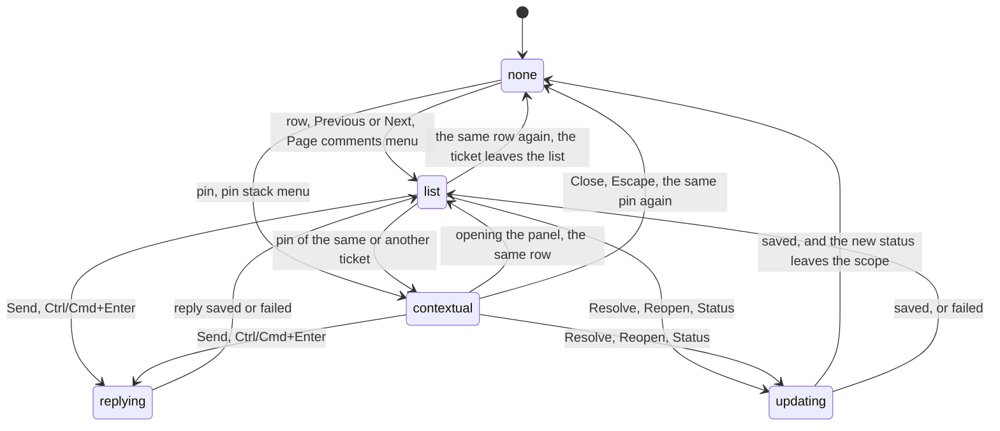

# Threads and replies

## Summary

A thread is a ticket shown in full in the review layer: its comment, its replies, a reply field, the controls that change its status, where it came from, and a link to it on the Shiplet page. A thread is shown in one of two places. In the **list presentation** it expands in place inside the comments panel. In the **contextual presentation** it opens in a card beside the ticket's pin on the artifact. At most one thread is active at a time, and it can move between the two places without losing anything typed. Threads are opened from a row in the panel, from Previous and Next, from a pin, from a pin stack's menu, or from the Page comments menu. Replying and changing status are open to everyone who can view the Shiplet. This document owns which thread is active and where, the reply field and its sending, and Resolve, Reopen, and the Status picker. The list around threads is in [the comments panel](the-comments-panel.md); pins and the menus that open threads are in `review/pins.md`.

## The simple case

In the open comments panel, the reviewer selects the row for PF-2. The row expands: the full comment, two earlier replies with their authors and times, a reply field ("Reply to this thread…"), and under it Resolve, Status, "Current revision", and Open feedback. The artifact scrolls to PF-2's target. They type "Fixed in the next build" and press Ctrl/Cmd+Enter. The field and its Send button go grey with "Sending reply to PF-2…", and a moment later the reply appears at the end of the replies, the field empties, and the thread says "Reply added to PF-2." They select Resolve: "Updating PF-2 status…", then the thread closes and PF-2 leaves the list, because the panel shows open tickets and PF-2 is now Done.

Clicking PF-3's pin on the artifact instead opens PF-3's thread in a card next to the pin, titled "PF-3", with the same contents and a Close button. Escape or Close closes the card and puts focus back on the pin.

## The interaction, event by event

(After a reply or a status change, the thread stays in whichever presentation it was in; the diagram shows the list for brevity.)

### Arrive

**Opening.** A row's summary, Previous or Next, or a Page comments menu item opens the thread in the list presentation; a pin or a pin stack menu item opens it in the contextual presentation. Opening any thread closes the one that was active. Every way of opening also asks the artifact to scroll the ticket's target into view, when it has one on this page (`review/pins.md` owns revealing).

**What a thread shows**, in this order: the comment; the replies, oldest first, each with its author (an email address, or "Reviewer") and time, at most 100; the reply field with, when the organization has people to mention, a "Mention reviewers in reply to {label}" list, and a Send button; a line for the thread's last message; then **Resolve** (or **Reopen** when the ticket is closed), a **Status** disclosure holding the Status picker with all six statuses, a **provenance** disclosure ("Current revision", "Earlier revision", or "Earlier feedback", expanding to "Current revision · {revision id}" or "Revision unknown"), and **Open feedback**, which opens the Shiplet page in a new tab.

**The list presentation** expands the row in place and hides its two-line preview. **The contextual presentation** is a card, 280 to 440 px wide and 240 to 560 px tall within the window, placed to the right of the pin when it fits and to the left otherwise, its top 40 px above the pin, at least 8 px inside the window. Its heading is the ticket label and it has a Close button ("Close thread {label}"). When the ticket has a target that cannot currently be shown (hidden, scrolled away in a way the artifact cannot fix, or gone), the card says "Target unavailable". While the card is open the launcher dock and the Page comments button are hidden. The card follows its pin as the artifact scrolls; without a pin position it sits at the top left.

**Moving between presentations.** Opening the comments panel while a card is open moves the thread into the panel, expanded. Clicking a pin while the panel is open moves that ticket's thread into a card; its row in the panel collapses. Selecting the row of a thread that is open in a card brings it back into the list. Nothing typed is lost in either move.

Nothing is focused on opening from a row (focus stays on the row's summary); opening from a pin leaves focus on the pin.

### Leave untouched

Closing a thread records nothing. In the list, selecting the active row again collapses it. In a card, Close, Escape, or clicking the same pin again closes it and returns focus to the pin (or to the pin stack, or, if neither is visible, to Comments). Clicking elsewhere on the artifact does not close a card. Closing the panel hides a list thread without deactivating it; reopening the panel shows it still expanded.

### Begin editing

Typing in the reply field starts a reply draft for that ticket. It is kept in memory per ticket, survives the thread closing, moving between presentations, the panel closing, the list being refreshed or polled (the field keeps focus and its selection), and is written to the browser's storage with the next save, so it comes back after a reload ([sending and drafts](sending-and-drafts.md)). Choosing people in the reply's mention list is kept the same way. Nothing is validated and Send stays enabled.

### While editing

The reply field takes up to 5,000 characters, and Enter adds a line. Other tickets can be opened and other replies drafted at the same time; each ticket keeps its own draft. Polling and other reviewers' changes refresh the thread's comment, replies, and status around the draft without touching it. The status shown is the last one the server confirmed; while a status change of the reviewer's own is in flight, polling does not overwrite it.

### Submit

**Reply.** Send, or Ctrl/Cmd+Enter in the reply field (not with Shift or Alt, and not during an IME composition), sends the trimmed text and the chosen mentions. An empty reply does nothing. While it is sending, the reply field, its mention list, and Send are disabled and the thread says "Sending reply to {label}…"; a second Send cannot start. On success the reply appears at the end of the replies, the field and mention choices clear, and the thread says "Reply added to {label}." The ticket's watchers and anyone mentioned are notified. On failure the text and mentions stay, the controls come back, and the thread says "Could not reply to {label}. Try again." (as an alert). A reply sent this way has no identity of its own on the server, so trying again after a failure whose request in fact arrived adds the reply twice (see Open questions).

**Resolve, Reopen, and Status.** Resolve sets the ticket to Done and Reopen sets it to New; the Status picker sets any of the six. Choosing a status in the picker snaps it back to the current status until the server confirms the new one. While the change is in flight, Resolve or Reopen and the picker are disabled and the thread says "Updating {label} status…". On success the thread says "{label} status updated.", shows the new status, and offers Reopen or Resolve as appropriate; the Shiplet's watchers are notified. If the new status falls outside the panel's State filter (Done or Dropped in an Open scope, or the reverse), the ticket leaves the list at once and its thread closes. On failure the status stays as it was and the thread says "Could not update {label}. Try again." There is no confirmation step for any status change.

**Open feedback** opens `/shiplets/{Shiplet id}?feedback={ticket id}` in a new tab: the Shiplet page, which does not single out the ticket ([navigation and URLs](../foundations/navigation-and-urls.md#deep-links)).

## Modifiers

| Modifier | At arrival | During editing |
| --- | --- | --- |
| Role | Every role that can view sees and uses the same thread: reply, Resolve, Reopen, Status. The reply's mention list is empty (and hidden) for a reviewer who is not a member of the Shiplet's organization. Signed-out visitors see threads, but replies and status changes fail with "Could not reply to {label}. Try again." and "Could not update {label}. Try again." | Losing access makes the next reply or status change fail with the same messages, and the review identity is re-checked. |
| Shiplet state | No difference by visibility. | Archiving mid-thread makes replies and status changes fail. A new active revision published by an agent does not affect replies or status changes (only new tickets check the revision); after a reload, every existing ticket's provenance reads "Earlier revision". |
| Flags and preferences | The panel's State filter decides whether a status change removes the ticket from the list. Hide comments hides pins, so contextual threads can only be reached through the panel. No feature flag applies. | No effect. |
| Keyboard | Opening from a row keeps focus on the row; from a pin, on the pin. | Ctrl/Cmd+Enter sends a reply; Enter adds a line. Escape closes a contextual thread (keeping its draft); in the list, Escape climbs on and closes the panel. The Status picker is a native list: in browsers that apply arrow keys to a closed list, each arrow press changes the status. |
| Narrow screen | At 480 px or less the contextual card is clamped to the window like every other card; it may cover the pin. | No effect. |

## Cancel and interrupt

| Event | Before editing | While editing or submitting |
| --- | --- | --- |
| Escape or Cancel | A contextual thread closes and focus returns to its pin. A list thread stays open and Escape closes the panel. | The same. The reply draft is kept. A reply or status change in flight completes, and its result is shown the next time the thread is opened. |
| Leaving by a link inside Shiplet | Nothing is recorded. | The reply draft is saved first. A reply or status change in flight completes on the server; it is not offered for retry on return. |
| Browser back or forward | As leaving. | As leaving. |
| Reload, or the tab or window is closed | No thread is active after reload. | Reply drafts come back in their threads. A reply that was sending is not remembered as pending; if it reached the server it appears in the thread. |
| The window loses focus or the tab is hidden | No effect. | Reply drafts are saved at once. |
| Network lost | No effect. | "Could not reply to {label}. Try again." or "Could not update {label}. Try again."; drafts and statuses stay as they were. |
| Request fails | No effect. | As network lost; a refusal also re-checks the review identity. |
| Session expires or access is revoked | No effect until an action. | As request fails. |
| The same record changed in another tab | The thread shows the other tab's replies and status within 5 seconds. | The two tabs keep separate drafts for the same ticket in memory and overwrite each other's stored copy. |
| The same record changed by another person | Their replies and status changes appear within 5 seconds. If they close the ticket, it stays in an Open list with its old status until Refresh ([the comments panel](the-comments-panel.md#edge-cases)). | Their changes appear around the draft. A status change of the reviewer's own in flight is not overwritten; the server keeps whichever change arrives last. |
| Autofill, a password manager, or an input method (IME) writes into a field | No effect. | Ctrl/Cmd+Enter and Escape do nothing during an IME composition. |
| The artifact navigates to another page (review link only) | The active thread closes as the list reloads for the new page. | Drafts are saved for the old page and come back when the artifact returns to it. A reply or status change in flight still completes. |

## Interactions with other systems

**Permissions and roles.** Replying and changing status need only viewing ([access and roles](../foundations/access-and-roles.md)); there is no editor-only status.

**Validation and error display.** The only check is a non-empty reply (at most 5,000 characters). Failures appear under the reply field as fixed messages; raw server text is never shown.

**Unsaved changes and drafts.** Each ticket's reply text and mentions are a draft, kept across closing, moving, and reloading ([sending and drafts](sending-and-drafts.md)). Status changes have no draft.

**Undo.** None for replies, which cannot be edited or deleted. A status change is undone only by changing it back, which notifies watchers again.

**Optimistic updates and rollback.** None. The Status picker snaps back to the confirmed status until the server answers, so a failure has nothing to roll back.

**Offline and reconnection.** Replies and status changes fail offline and are retried by hand; drafts stay.

**Live updates and collaboration.** Polling updates the thread's comment, replies, and status every 5 seconds, preserving the reviewer's focus and selection in a reply field. A thread being read by two people at once shows each other's replies within 5 seconds.

**Status messages and notifications.** Each thread has its own message line ("Sending reply to PF-2…", "Reply added to PF-2.", "PF-2 status updated.", failures as alerts). Replies notify the ticket's watchers and mentioned people; status changes notify watchers (`cross-cutting/notifications-and-watching.md`).

**URL and browser storage.** The URL never changes. Reply drafts live with the other drafts in IndexedDB. Which thread was active is not stored.

**Localization and time.** English only. Reply times are in the browser's locale and time zone; status names are fixed English words.

**Accessibility.** The contextual card is a labeled region ("Thread {label}") and its Close button is named; the pin that opened it reports whether its thread is expanded. The reply field and Send are named for their ticket. Thread messages are status regions, and alerts for failures.

**Side effects others notice.** A reply is visible to everyone viewing the Shiplet within 5 seconds and in the Feedback view; it notifies watchers and mentioned people, and a mention of a member who could not view the Shiplet gives them access ([Shiplets and tickets](../foundations/shiplets-and-tickets.md#mentions)). A status change appears everywhere the ticket is listed and notifies watchers.

## Edge cases

- **Resolving removes the ticket from an Open list at once**, closing its thread; resolving it from elsewhere does not (polling cannot remove it).
- **A double reply is possible** after a failure whose request actually arrived, because replies are not deduplicated as tickets are.
- **Replies past 100** are not shown, and nothing says there are more.
- **Mentions in replies** are chosen from a list, not typed with "@": the inline suggestions exist only in the composer.
- **Open feedback lands on the Shiplet page without the ticket**: that page ignores the ticket in its address.
- **A thread whose ticket left the list** after Refresh stays open until it is closed, because Refresh keeps the active thread.
- **A thread with a target on another page** (listed under All authorized pages or Path prefix) opens in the list only; it has no pin here and revealing it does nothing.

## Open questions and verification

- Replies have no submission identity, so a retry after a lost response duplicates the reply. `docs/review-widget-parity-audit.md` WRITE-08 (no second in-flight reply) is closed; this is the different case of a retry after failure. May be worth treating as a bug rather than documenting.
- Arrow keys on the Status picker changing the status at once (WRITE-15 lists the native select gesture as unverified) were not tried.
- `e2e/trusted-review-host.spec.ts` was noted by the parity audit as expecting an "Update status for …" button the host no longer renders; whether that test currently passes was not checked.
- The card placement numbers (40 px above, 280 to 440 px wide) were read from code, not watched.
- Whether a status change made while the ticket is outside the scope (for example through All authorized pages) behaves the same was not tried.

Verified against shiplet-core commit `3327af4`
