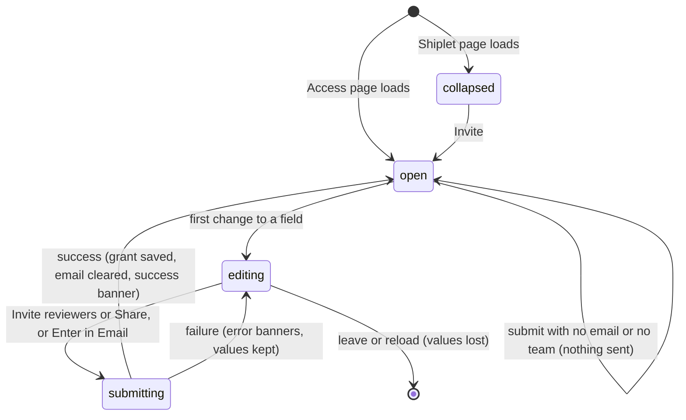

# The invite reviewers form

## Summary

The invite reviewers form gives one person, one team, or the whole organization a role on one Shiplet. For a person it also sends an invitation email. It is the only place in the web app where access to a single Shiplet is granted, and it appears twice with the same behavior: as "Invite reviewers" in the side column of the Shiplet page (`/shiplets/{id}`), hidden behind an Invite button, and as the form at the bottom of "Shiplets and sharing" on the Access settings page (`/access`), always open, where the Shiplet is chosen from a list and the button reads Share. Every person who can open the Shiplet page sees the form, but only someone who can edit the Shiplet (its owner, an organization administrator, or an editor or owner grant holder; see [access and roles](../foundations/access-and-roles.md)) can submit it successfully. It has no offline or read-only mode.

## The simple case

On the Shiplet page, the person selects Invite. The button disappears and four controls appear in its place: Share with (User), Email, Role (Reviewer), and an Invite reviewers button. They type a teammate's email address and select Invite reviewers.

When the server answers, the Email field empties, a green banner under the form reads "Invite sent. The reviewer can open the shared shiplet and leave feedback.", and the banner at the top of the page reads "Shiplet access updated." The fields stay open with their other choices intact, ready for the next address. The invitee receives an invitation email from WorkOS; nothing else on the page changes, because the web app has no list of who has access to a Shiplet.

Choosing Team or Organization instead of User grants the role at once, with no email: every member of that team, or of the Shiplet's organization, can open the Shiplet from then on.

## The interaction, event by event

### Arrive

On the Shiplet page the section "Invite reviewers" shows a sentence ("Send teammates straight into the artifact so feedback starts as contextual comments.") and an Invite button; the fields are hidden. The page then loads the person's workspace in the background (the top banner reads "Loading workspace..." until it finishes and then "Workspace ready."), and that load fills the Team list with the teams of the Shiplet's organization. Until it finishes, the Team list is empty.

Selecting Invite hides the button for the rest of the page's life and shows the fields: Share with set to User, an empty Email field (placeholder "reviewer@example.com"), and Role set to Reviewer. Role offers Reviewer, Viewer, and Owner, in that order. Nothing is focused; focus stays wherever the browser put it after the Invite button vanished, which is the page itself.

On the Access page the form is open from the start, under a table of the active organization's Shiplets. Its first control is a Shiplet list holding the active organization's active Shiplets, then Share with, Email, Team (hidden), Role, and a Share button. Here Role offers Viewer, Reviewer, and Owner, so the default is Viewer, not Reviewer. Changing the Active organization select above the table refills the Shiplet list and the Team list.

Nothing is prefilled from the Shiplet, the person, or earlier use, and nothing is validated on arrival.

### Leave untouched

Leaving the page, reloading it, or simply never selecting Invite records nothing: no request is sent, nothing is stored in the browser, and the next visit shows the collapsed section again. There is no way to collapse the fields once Invite has shown them; only a reload brings the Invite button back.

Submitting without changing anything is also a short path. With Share with left at User and the Email field empty, Invite reviewers does nothing at all: no request, no message, no focus change. The same is true for Team when the Team list is empty. Organization needs no other field, so an untouched Organization choice does submit.

### Begin editing

The first change does not make the form dirty in any visible way: no button enables, no message appears, and nothing is saved. The form's only live behavior is Share with, which swaps the field under it the moment it changes:

- User shows Email and hides Team.
- Team shows Team and hides Email.
- Organization hides both.

A hidden field keeps its value. An email typed before switching to Team is still there after switching back to User, and it is ignored while Team is chosen.

### While editing

No validation runs while typing. The Email field is a browser email field, so the browser checks its format (something@something) only when the form is submitted, and shows its own message bubble on the field if the format is wrong; an empty field passes that check. Nothing is saved locally, the URL does not change, and the Shiplet page does not poll, so nothing on it changes while the person types. The Team list is the one loaded on arrival; a team created in another tab does not appear until the page is reloaded.

### Submit

Selecting Invite reviewers (or Share), or pressing Enter in the Email field, runs the browser's format check on Email and then the form's own guard: for User the trimmed email must be non-empty, and for Team a team must be chosen; otherwise nothing happens. Then one request goes to the server with the Shiplet, the target, and the role. Nothing is disabled while it is in flight and no progress is shown; a result banner left by an earlier attempt stays until this one answers.

The server checks, in this order, that the person is signed in, that the Shiplet exists and belongs to an organization, that the person can edit it, and that the role is viewer, reviewer, or editor. Then it saves:

- **User:** an invitation through WorkOS to the email address (lowercased), which is an invitation to join the Shiplet's organization as a member; a pending Shiplet invitation carrying the role; and a grant for that email. The grant does not open the Shiplet yet. The invitee gets access when they accept from the invitation email while signed in with exactly that address, and accepting also makes them a member of the organization.
- **Team:** a grant to that team, effective immediately for every current and future member of the team.
- **Organization:** a grant to the Shiplet's organization, effective immediately for every member.

On success the Email field empties (Share with, Team, and Role keep their values), the banner under the form shows the success message quoted in the simple case, and the top banner reads "Shiplet access updated." The success message is the same for all three targets and all roles, even though only User sends anything. The person stays on the page with the form open.

On failure, both banners show the server's text verbatim in red, and every field keeps its value. The messages a person can meet are listed under [Validation and error display](#interactions-with-other-systems).

## Modifiers

| Modifier | At arrival | During editing |
| --- | --- | --- |
| Role | Everyone who can open the Shiplet page sees the section and can open the fields. Only the owner, an organization administrator, or an editor or owner grant holder can submit successfully; anyone else gets "Shiplet editor access required" after submitting. On the Access page the Shiplet list includes Shiplets the person can view but not edit. | Authority is checked when the request arrives, not when the page loaded: losing editor rights in another tab makes the next submit fail, and gaining them makes it succeed, without a reload. |
| Shiplet state | Visibility changes what a grant adds, not how the form behaves. An Organization grant opens a Private Shiplet to every member but changes nothing on an Organization, Unlisted, or Public one; a User grant on an Unlisted or Public Shiplet adds nothing to viewing, but its invitation still makes the invitee an organization member. An archived Shiplet's page still shows the form and the server accepts the grant; the Access page's Shiplet list leaves archived Shiplets out. | Archiving or restoring the Shiplet elsewhere does not affect a submit. Permanently deleting it makes the submit fail with "Shiplet not found". |
| Flags and preferences | No effect. No feature flag touches the form, and the theme only changes colors. | No effect. |
| Keyboard | Tab moves through the Shiplet list (Access page only), Share with, Email (or Team), Role, then the button; a hidden field is skipped. Enter or Space on Invite opens the fields. Enter in Email submits; Enter in a list does not. Escape does nothing. | Enter in Email while a request is in flight sends a second, identical request. |
| Narrow screen | No change at 640 px. At 900 px or less the Shiplet page stacks its columns, so the form appears below the embedded review and the comment list. | No effect. |

Changing Role or Share with while a request is in flight does not affect that request; the values were read when the form was submitted.

## Cancel and interrupt

| Event | Before editing | While editing or submitting |
| --- | --- | --- |
| Escape or Cancel | No effect. There is no Cancel button and Escape is not handled; the fields stay open. | No effect. Typed values stay, and a request in flight completes. |
| Leaving by a link inside Shiplet | Nothing is recorded. | Typed values are lost without a warning. A request already sent still completes on the server (grant saved, invitation sent), but its result is never shown. |
| Browser back or forward | Nothing is recorded. | As leaving. Coming back to the Access page shows a fresh, empty form, because that page is marked never to be cached; coming back to the Shiplet page may show it as it was if the browser kept it in its back-forward cache. |
| Reload, or the tab or window is closed | Nothing is recorded; a reload shows the collapsed section again. | Typed values are lost. A request already sent still completes. |
| The window loses focus or the tab is hidden | No effect. | No effect. A request in flight completes in the background and its banners are waiting on return. |
| Network lost | No effect until the next submit. | The submit fails and both banners show the browser's network error (in Chrome, "Failed to fetch"). Values are kept; submitting again retries. If the connection dropped after the server received the request, the grant was saved and the invitation sent even though the page shows an error, and the retry saves a second grant and sends a second email. |
| Request fails | No effect. | Both banners show the server's message; values are kept. A refusal (no edit rights, a bad role, a missing team) or a WorkOS failure saves nothing. A failure after WorkOS accepted the invitation, while the Shiplet's own records were being written, leaves an invitation email sent with no grant behind it. |
| Session expires or access is revoked | No effect until the next submit. | The submit fails with "Authentication required" (signed out) or "Shiplet editor access required" (edit rights removed). The page does not redirect; reloading goes through sign-in and returns to the page ([navigation and URLs](../foundations/navigation-and-urls.md)). |
| The same record changed in another tab | No effect; the page does not notice. | A team or Shiplet created in another tab is missing from the lists until reload. Granting the same target from both tabs saves two grants. |
| The same record changed by another person | No effect; the page does not notice. | As in another tab. Another person removing this person's edit rights makes the next submit fail. |
| Autofill, a password manager, or an input method (IME) writes into a field | The browser may offer saved addresses for Email; accepting one fills the field without submitting. | No special handling. Enter that ends an IME composition does not submit; the next Enter does. |
| The artifact navigates to another page (review link only) | No effect. The embedded review on the Shiplet page navigating inside its own frame does not touch this form. | No effect. |

After any interrupt the person stays where they are (or wherever they navigated to); there is no draft to restore and no partial state on the server other than what a completed request saved. What these events mean across the product is defined in [the page lifecycle](../foundations/page-lifecycle.md).

## Interactions with other systems

**Permissions and roles.** The form never hides itself by role; the server decides at submit time, using the edit rule in [access and roles](../foundations/access-and-roles.md). The form cannot give editing: Owner is always refused (see Edge cases) and Editor is not offered, so the only roles it can grant are Reviewer and Viewer, which give the same authority (view, comment, reply, change ticket status).

**Validation and error display.** The browser checks the email format; the form ignores an empty email or an empty team silently. Everything else is the server's plain-text message shown twice, in the top banner and the banner under the form, with no field highlighted: "Authentication required", "Shiplet editor access required", "Shiplet not found", "Team not found", "Shiplet is missing organization scope", "role must be viewer, reviewer, or editor", or "Failed to share shiplet: {reason}" when WorkOS refuses the invitation. A message stays until the next submit or reload.

**Unsaved changes and drafts.** None. Nothing typed is kept anywhere, and leaving never asks for confirmation.

**Undo.** None, and no later removal either: the web app has no list of a Shiplet's grants or pending invitations and no way to revoke one.

**Optimistic updates and rollback.** None. Nothing changes on screen until the server answers, so there is nothing to roll back.

**Offline and reconnection.** No queue and no automatic retry; the person resubmits.

**Live updates and collaboration.** The Shiplet page does not poll. The Access page polls for notification and feedback counts (for its navigation badges) but never refreshes the form's lists.

**Status messages and notifications.** Results appear only in the two banners, which are not announced to screen readers. No Inbox notification is created for anyone; see `cross-cutting/notifications-and-watching.md` for what does notify.

**URL and browser storage.** Nothing. The form leaves the URL alone and stores nothing in the browser.

**Localization and time.** English only. The form shows no dates or times.

**Accessibility.** Every field has a visible label. Selecting Invite removes the focused button from the page without moving focus to the first field, so a keyboard or screen reader user lands on the page itself and has to find the fields. Results are not announced.

**Side effects others notice.** A User grant sends a WorkOS invitation email to the address, inviting it into the organization, and accepting it makes the invitee an organization member who can then also see every Organization-visibility Shiplet. Team and Organization grants take effect silently for every member. Attempts are written to Shiplet's administrative audit history (a denial when the person cannot edit; otherwise an intent followed by a success or a failure), which no page of the web app shows.

## Edge cases

- **Owner is always refused.** The Role list offers Owner, and the server accepts only viewer, reviewer, and editor, so choosing Owner always ends in "role must be viewer, reviewer, or editor". Editor, the role the server would accept for edit rights, is not in the list.
- **Inviting the same address twice** saves two grants and sends two invitation emails. Nothing warns that the address was already invited, already a member, or already able to view.
- **Double submit.** Two quick clicks, or Enter twice, send two requests, with the same result as inviting twice.
- **The success message overstates.** "Invite sent. The reviewer can open the shared shiplet and leave feedback." appears for Team and Organization grants, which send nothing, and for a User grant, whose invitee cannot open a Private or Organization-visibility Shiplet until they accept the invitation.
- **An invitee who opens the review link directly** while signed in, before accepting, is sent to the access request page, not to the invitation; the invitation email's link is the way in. See `access/the-access-gate.md`.
- **Case and spaces in the email** are ignored: the address is trimmed by the page and lowercased by the server.
- **Organization on an Organization-visibility Shiplet** saves a grant that changes nothing anyone can see.
- **Team with no teams.** If the organization has no teams, choosing Team shows an empty list and the button does nothing. Teams are created on the Workspace page (`access/the-workspace-page.md`).
- **Access page with no Shiplets.** If the active organization has no active Shiplets, the Shiplet list is empty and Share does nothing.
- **Different defaults.** The same form defaults to Reviewer on the Shiplet page and Viewer on the Access page.

## Open questions and verification

- Owner always failing, and Editor missing, looks like a bug rather than a design: `docs/access-control.mdx` says editing comes from an accepted grant with the owner or editor role, and this form cannot create either. May be worth treating as a bug rather than documenting.
- The web app cannot list or revoke a Shiplet's grants or pending invitations. Confirm whether that is intended for this release.
- Duplicate grants and emails from repeated or double submits: no pending state and no deduplication were found in the page or the server. Worth confirming by hand with a held request.
- A User invitation joins the invitee to the whole organization as a member. That widens what they can see beyond the one Shiplet, which `docs/access-control.mdx` ("a Shiplet can also grant access to an individual exact email address") does not mention. This needs a product call.
- What WorkOS does when the address already belongs to an organization member, or to the inviter, was not determined from code; test mode accepts everything. Needs a run against a real WorkOS application.
- Whether the Shiplet page is restored from the browser's back-forward cache (with the fields open and the email typed) was not tested; the Access page sets no-store, the Shiplet page does not.
- Neither banner is an announced live region, read from markup; confirm with a screen reader.
- The success message's wording for Team and Organization grants and for invitations not yet accepted.

Verified against shiplet-core commit `3327af4`
